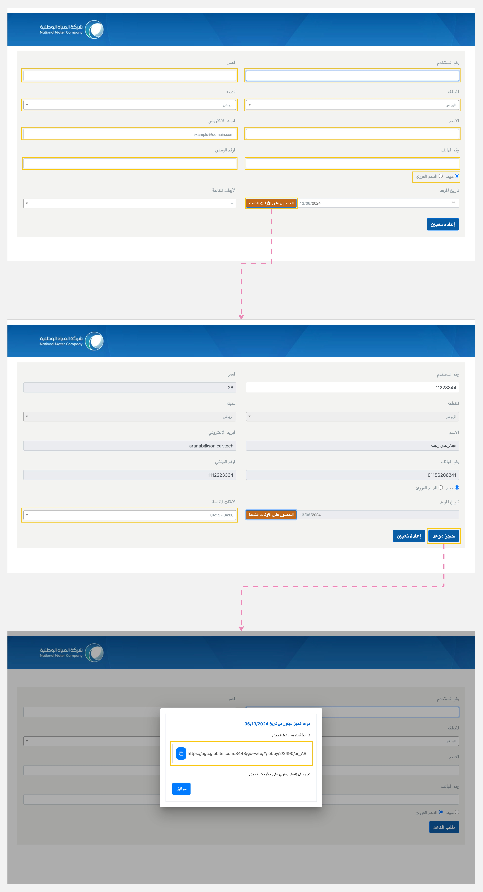

---
tags:
  - طلب مكالمة
  - حجز مكالمة
  - إجراء مكالمة
hide:
  - toc
---
# حجز/ إجراء مكالمة

---
كعميل، لديك القدرة على حجز موعد جديد أو دعم فوري، مما سيؤدي إلى بدء التفاعل مع أحد موظفين خدمة العملاء.

كيف تطلب/ تحجز موعداً جديداً؟

1. انتقل إلى عنوان URL الذي يوفره دعم العملاء أو ابحث عنه في صفحة دعم العملاء.
2. أدخل المعلومات الشخصية اللازمة: الهوية الوطنية ورقم الحساب ونوع الحساب والاسم والعمر والهاتف المحمول والبريد الإلكتروني وحدد المدينة.
3. اختر نوع الاجتماع الذي تريده. هناك خياران: "موعد"، والذي يمكّنك من تحديد تاريخ ووقت مخصصين عن طريق إختيار "الحصول على الأوقات المتاحة"، أو "الدعم الفوري"، وهو لطلب اجتماع الآن.
4. انقر على "حجز موعد" لبدء عملية طلب الاجتماع.
5. ستظهر نافذة منبثقة تحتوي على رابط اجتماعك.
6. إذا كنت قد اخترت الدعم الفوري، يمكنك نسخ الرابط ولصقه في علامة تبويب متصفح جديدة لـ [بدء اجتماع](Starting-a-Meeting.md) مع أحد موظفين خدمة العملاء.

!!! tip "تلميح"
    إذا قمت بحجز اجتماع، سيتم إرسال رسالة بريد إلكتروني تحتوي على رابط الاجتماع والتفاصيل الخاصة بك.

