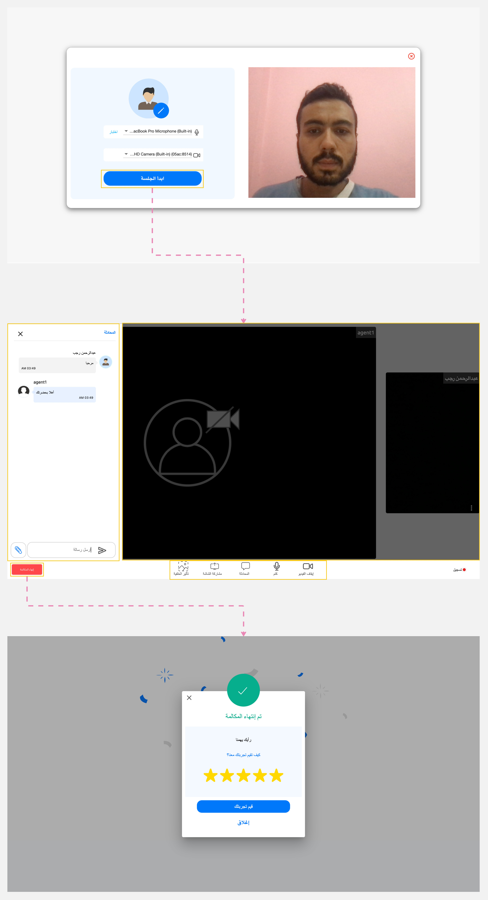

---
tags:
  - بدء المكالمة
  - إدارة الإجتماع
  - التحدث مع موظف خدمة العملاء
---
# بدء الإجتماع

---
بعد [طلب اجتماع](Requesting-a-Meeting.md)، انقر على "أبدء الجلسة" لبدء التفاعل مع أحد موظفي خدمة العملاء.

!!! warning "تنبيه"
    تأكد من تفعيل الميكروفون الافتراضي وتشغيل الكاميرا إذا تطلب الأمر قبل بدء التفاعل مع موظف خدمة العملاء.

سيتم عرض غرفة الإجتماع، وتضم قسمين:

1. لوحة الاجتماع: يُظهر هذا القسم حالة البث المباشر وحالة الميكروفون لكل من موظف خدمة العملاء ولك.
2. وظائف الاجتماع: يحتوي هذا القسم على العديد من الإجراءات التي يمكنك القيام بها أثناء الاجتماع.

## وظائف الاجتماع

فيما يلي سبع وظائف يمكنك استخدامها أثناء تفاعلك مع موظف خدمة العملاء في غرفة الإجتماع:

1. تشغيل/إيقاف الكاميرا.
2. كتم/إلغاء كتم صوت الميكروفون الخاص بك.
3. [مشاركة شاشتك](../Handling-Interactions/Screen-sharing.md) مع موظف خدمة العملاء.
4. [تغيير الخلفية](../Handling-Interactions/Change-background-and-blur.md) أثناء تشغيل الكاميرا.
5. [الدردشة](../Handling-Interactions/Chat.md) مع موظف خدمة العملاء.
6. [تبادل المستندات](../Handling-Interactions/Exchanging-documents.md) مع موظف خدمة العملاء.
7. أغلق الخط لإنهاء الاجتماع وسيتم ظهور صفحة لتقييم تجربتك.

!!! tip "تلميح"
    بعد إنهاء المكالمة، يمكنك تقييم تجربتك مع موظف خدمة العملاء على مقياس من ١ إلى ٥ نجوم، بحيث تكون ٥ هي الأعلى و١ هي الأقل.

