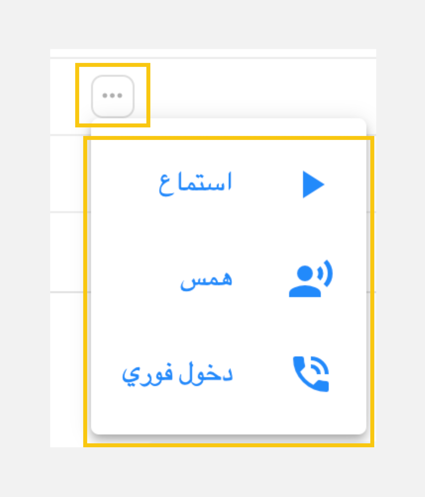
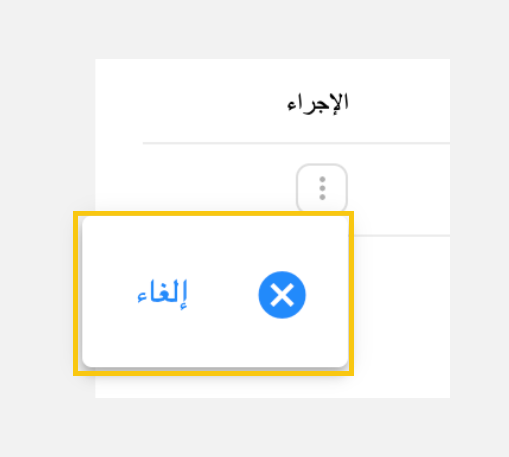

# الأسئلة الشائعة

إجابات سريعة عن الأسئلة الأكثر تكرارًا. اختر دورك للانتقال مباشرة إلى الأسئلة التي تهمك.

[:material-information-outline: أسئلة عامة](#general){ .gc-faq-chip }
[:material-headset: موظفو خدمة العملاء](#agents){ .gc-faq-chip }
[:material-account-voice: العملاء](#customers){ .gc-faq-chip }
[:material-monitor-dashboard: المشرفون](#supervisors){ .gc-faq-chip }
[:material-shield-account-outline: مسؤولو النظام](#administrators){ .gc-faq-chip }

## أسئلة عامة { #general }

???+ question "ما هو نظام جلوبيتل كونكت؟"
    جلوبيتل كونكت منصة للتواصل مع العملاء عبر الفيديو. يمكن للعميل حجز موعد أو طلب دعم فوري، ثم التحدث وجهًا لوجه مع موظف خدمة العملاء عبر الفيديو والمحادثة ومشاركة الملفات.

    يوفر النظام بوابتين:

    - **بوابة موظفي خدمة العملاء والمشرفين**: للتعامل مع مكالمات العملاء ومتابعة الفريق. [ابدأ من هنا](../Getting-started/Login.md)
    - **بوابة الإدارة**: لإدارة المستخدمين والفرق والمهارات وقواعد التوجيه وإعدادات النظام. [دليل الإدارة (بالإنجليزية)](/en/Administration/log-in/)

??? question "كيف أفتح نظام جلوبيتل كونكت؟"
    1. افتح متصفح الويب (يُنصح باستخدام جوجل كروم).
    2. أدخل العنوان الذي زودك به مسؤول النظام بالصيغة التالية: `http://Server_Name:Port/gc-mobile`.
    3. سجّل الدخول باستخدام **اسم المستخدم** و**كلمة المرور**.

    [اقرأ الدليل الكامل](../Getting-started/Login.md){ .gc-faq-more }

??? question "ما المتصفح الذي يجب أن أستخدمه؟"
    نوصي باستخدام **جوجل كروم (Google Chrome)** على ويندوز أو ماك أو لينكس. [تنزيل كروم](https://www.google.com/chrome/).

??? question "كيف أغيّر لغة النظام؟"
    انقر على القائمة المنسدلة بجوار صورة ملفك الشخصي في رأس الصفحة، ثم اختر **English** أو **العربية**.

??? question "كيف أغيّر كلمة المرور؟"
    1. انقر على القائمة المنسدلة بجوار صورة ملفك الشخصي في رأس الصفحة.
    2. اختر **تغيير كلمة المرور**.
    3. أدخل كلمة المرور الحالية، ثم أدخل كلمة المرور الجديدة وأكّدها، وانقر على **حفظ**.

    !!! tip "تلميح"
        استخدم ثمانية أحرف على الأقل، تتضمن رقمًا وحرفًا خاصًا وحرفًا كبيرًا وحرفًا صغيرًا.

    [اقرأ الدليل الكامل](../My-profile/Change-password.md){ .gc-faq-more }

## موظفو خدمة العملاء { #agents }

??? question "هل أحتاج إلى كاميرا وميكروفون؟"
    نعم. يجب أن يحتوي جهازك على كاميرا وميكروفون يعملان (مدمجين أو خارجيين)، وبدونهما لن تتمكن من استقبال مكالمات العملاء.

    [اختبر الكاميرا والميكروفون](../Getting-started/Testing-your-camera-and-microphone.md){ .gc-faq-more }

??? question "لماذا يجب أن أشارك الشاشة بالكامل؟"
    مشاركة الشاشة مطلوبة **لأغراض مراقبة الجودة**، إذ يسجّل النظام نشاط شاشتك أثناء العمل. لن تتمكن من فتح لوحة القيادة أو التعامل مع المكالمات قبل مشاركة الشاشة بالكامل.

    عند ظهور النافذة المنبثقة بعد تسجيل الدخول:

    1. اختر علامة التبويب **الشاشة بأكملها**.
    2. حدد شاشتك.
    3. انقر على **مشاركة**.

    [اقرأ الدليل الكامل](../Getting-started/Share-screen.md){ .gc-faq-more }

??? question "كيف أبدأ في استقبال المكالمات؟"
    انقر على زر **جاهز** أسفل لوحة ملفك الشخصي في لوحة القيادة. ما لم تكن في حالة "جاهز"، يعتبرك النظام مشغولًا ولن يرسل إليك أي مكالمات.

    [اقرأ الدليل الكامل](../Getting-started/Getting-ready-for-engagements.md){ .gc-faq-more }

??? question "لا تصلني أي مكالمات، ماذا أتحقق منه؟"
    راجع القائمة التالية:

    - [x] حالتك **جاهز**. تفويت مكالمة يغيّر حالتك إلى **غير جاهز**، لذا اضغط **جاهز** مرة أخرى.
    - [x] شاركت **الشاشة بأكملها** بعد تسجيل الدخول.
    - [x] الكاميرا والميكروفون يعملان بشكل صحيح. [أجرِ الاختبار](../Getting-started/Testing-your-camera-and-microphone.md).
    - [x] تستخدم أحدث إصدار من جوجل كروم.

    إذا كان كل شيء سليمًا ولا تزال المكالمات لا تصل، تواصل مع مشرفك أو مسؤول النظام.

??? question "ماذا يحدث إذا فاتتني مكالمة أو رفضتها؟"
    - **مكالمة فائتة**: إذا لم تُجب خلال **5 ثوانٍ**، تُحوَّل المكالمة إلى موظف آخر جاهز وتتغير حالتك إلى **غير جاهز**.
    - **مكالمة مرفوضة**: تعود المكالمة إلى قائمة الانتظار ويُسجَّل الرفض في النظام. لا ترفض المكالمات إلا في الحالات الطارئة.

    [اقرأ الدليل الكامل](../Handling-Interactions/Receiving-a-new-interaction.md){ .gc-faq-more }

??? question "ماذا يمكنني أن أفعل أثناء المكالمة؟"
    من غرفة الاجتماع يمكنك:

    - [المحادثة مع العميل](../Handling-Interactions/Chat.md)
    - [مشاركة الملفات](../Handling-Interactions/Exchanging-documents.md)
    - [مشاركة شاشتك](../Handling-Interactions/Screen-sharing.md)
    - [تغيير الخلفية أو تمويهها](../Handling-Interactions/Change-background-and-blur.md)
    - [تحويل المكالمة إلى موظف آخر](../Handling-Interactions/Call-Transfer.md)
    - [دعوة آخرين إلى اجتماع جماعي](../Handling-Interactions/Conference-room-functions.md)

??? question "كيف أرسل ملفًا إلى العميل؟"
    1. انقر على **المحادثة** في غرفة الاجتماع.
    2. انقر على أيقونة **ملف** واختر الملف.
    3. اضغط **Enter** لإرساله.

    يمكنك إرسال الصور ومقاطع الفيديو والمستندات (PDF وDOCX وXLSX) والملفات المضغوطة (ZIP).

    !!! warning "تنبيه"
        نزّل الملفات المهمة قبل انتهاء المكالمة، فملفات المحادثة تُحذف عند انتهائها.

    [اقرأ الدليل الكامل](../Handling-Interactions/Exchanging-documents.md){ .gc-faq-more }

??? question "كيف أغيّر صورتي الشخصية؟"
    في قسم الملف الشخصي داخل لوحة القيادة، انقر على **أيقونة الكاميرا** بجوار صورتك والتقط صورة جديدة. تظهر هذه الصورة للعملاء أثناء المكالمات.

    [اقرأ الدليل الكامل](../My-profile/Modify-profile-photo.md){ .gc-faq-more }

??? question "أين أجد مواعيدي القادمة؟"
    افتح علامة التبويب **مواعيدي** في لوحة القيادة، حيث يظهر وقت كل موعد وحالته: قادم أو مُعاد جدولته أو مكتمل أو ملغى.

    [اقرأ الدليل الكامل](../Getting-started/Appointments.md){ .gc-faq-more }

## العملاء { #customers }

??? question "كيف أطلب اجتماعًا مع موظف خدمة العملاء؟"
    1. افتح الرابط الذي زودك به فريق خدمة العملاء.
    2. أدخل بياناتك.
    3. اختر نوع الاجتماع:
        - **موعد**: اختر التاريخ والوقت المناسبين لك.
        - **دعم فوري**: تحدّث مع موظف خدمة العملاء الآن.
    4. انقر على **حجز موعد**، وستظهر نافذة منبثقة تحتوي على رابط الاجتماع.

    [اقرأ الدليل الكامل](../Customer-Access/Requesting-a-Meeting.md){ .gc-faq-more }

??? question "هل سيصلني رابط الاجتماع عبر البريد الإلكتروني؟"
    نعم. بعد الحجز ستصلك رسالة بريد إلكتروني تحتوي على رابط الاجتماع وتاريخه ووقته وبياناتك.

??? question "كيف أنضم إلى الاجتماع؟"
    1. افتح رابط الاجتماع في المتصفح.
    2. شغّل الميكروفون والكاميرا.
    3. انقر على **أبدء الجلسة** لبدء الحديث مع موظف خدمة العملاء.

    [اقرأ الدليل الكامل](../Customer-Access/Starting-a-Meeting.md){ .gc-faq-more }

??? question "ماذا يمكنني أن أفعل أثناء الاجتماع؟"
    يمكنك تشغيل الكاميرا أو إيقافها، وكتم الميكروفون، و[مشاركة شاشتك](../Handling-Interactions/Screen-sharing.md)، و[تغيير الخلفية](../Handling-Interactions/Change-background-and-blur.md)، و[المحادثة](../Handling-Interactions/Chat.md) و[تبادل الملفات](../Handling-Interactions/Exchanging-documents.md) مع موظف خدمة العملاء.

    عند إنهاء المكالمة يمكنك تقييم تجربتك من 1 (الأقل) إلى 5 (الأعلى).

## المشرفون { #supervisors }

??? question "كيف أتابع أداء فريقي؟"
    استخدم **مراقبة الفريق** من أجل:

    - [تتبع أداء كل موظف](../Real-Time-Monitor/Track-agents-performance.md): عدد المكالمات ومتوسط مدة المعالجة ورضا العملاء.
    - [متابعة حالة الفريق ومواعيده مباشرة](../Real-Time-Monitor/Monitoring-current-interactions.md)، مع إمكانية الفلترة حسب اليوم أو الأسبوع أو الشهر الحالي أو الشهر الماضي.

??? question "هل يمكنني الاستماع إلى مكالمة جارية لموظف أو الانضمام إليها؟"
    { width=65, align=left }
    نعم. من علامة التبويب **حالة الفريق**، انقر على أيقونة الخيارات (:material-dots-horizontal-circle:) بجوار المكالمة الجارية:

    - **الاستماع**: استمع إلى المكالمة دون أن يُسمع صوتك.
    - **الهمس**: وجّه الموظف بحيث يسمعك هو فقط.
    - **الانضمام الفوري**: انضم إلى المكالمة لتصبح محادثة ثلاثية.

    [اقرأ الدليل الكامل](../Real-Time-Monitor/Monitoring-current-interactions.md){ .gc-faq-more }

??? question "كيف ألغي موعد أحد العملاء؟"
    { width=65, align=left }
    افتح علامة التبويب **مواعيد الفريق**، وانقر على أيقونة الخيارات (:material-dots-horizontal-circle:) بجوار الموعد، ثم اختر **إلغاء** وأكّد. سيصل إشعار بالإلغاء إلى العميل.

??? question "هل يمكنني تصدير مواعيد الفريق؟"
    نعم. من **مواعيد الفريق** اختر تاريخ البداية والنهاية، ثم انقر على **تصدير** لتنزيل ملف Excel.

??? question "هل يحتاج المشرف إلى ضبط حالته على "جاهز"؟"
    نعم، إذا كنت تستقبل مكالمات محوّلة من فريقك. وإلا سيعتبرك النظام مشغولًا ولن تصلك المكالمات المحوّلة.

## مسؤولو النظام { #administrators }

!!! info "ملاحظة"
    دليل بوابة الإدارة متوفر باللغة الإنجليزية فقط.

??? question "ماذا يمكنني أن أدير من بوابة الإدارة؟"
    - [إحصائيات لوحة القيادة](/en/Administration/My-Dashboard/)
    - المستخدمون والأدوار والفرق والمهارات: [المستخدمون](/en/Administration/User-Management/Users-Management/)، [الأدوار](/en/Administration/User-Management/Roles-Management/)، [الفرق](/en/Administration/User-Management/Teams-Management/)، [المهارات](/en/Administration/User-Management/Skills-Management/)
    - [إعدادات النظام](/en/Administration/System-Management/System-Settings/) و[نموذج العميل](/en/Administration/System-Management/Customer-Form/) و[قواعد التوجيه](/en/Administration/System-Management/Routing-Rules/)
    - [تفاصيل الترخيص](/en/Administration/About-System/)

??? question "كيف أضيف مستخدمًا جديدًا؟"
    1. انتقل إلى **إدارة المستخدمين** > **المستخدمون**.
    2. انقر على أيقونة الإضافة (:octicons-diff-added-16:).
    3. أدخل بيانات المستخدم واختر مجموعته وفريقه ومهاراته.
    4. انقر على **حفظ**.

    [اقرأ الدليل الكامل (بالإنجليزية)](/en/Administration/User-Management/Users-Management/){ .gc-faq-more }

??? question "أين أجد حدود الترخيص الخاص بي؟"
    افتح **عن النظام** من القائمة الجانبية لعرض إصدار المنتج والحد الأقصى لعدد موظفي خدمة العملاء المسموح به في ترخيصك.

    [اقرأ الدليل الكامل (بالإنجليزية)](/en/Administration/About-System/){ .gc-faq-more }

## هل ما زلت بحاجة إلى مساعدة؟ { #help }

اسأل المساعد الذكي الذي يجيب من هذا الدليل، أو تواصل مع فريق جلوبيتل.

[:material-creation: اسأل المساعد الذكي](#){ .md-button .md-button--primary .gc-help__chat data-gc-chat-open="true" }
[:material-email-outline: راسل الدعم](mailto:info@globitel.com){ .md-button }

