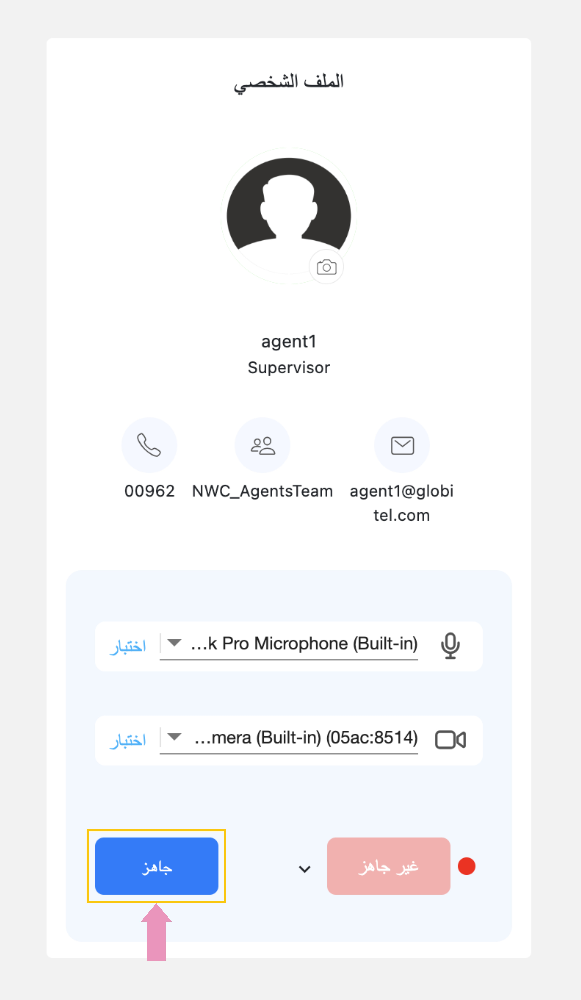

---
tags:
  - جاهز للتفاعل
  - جاهز
  - جاهز لإستقبال مكالمات
  - مستعد لإستقبال
hide:
  - toc
---

# جاهز لإستقبال مكالمات

---
الآن بعد أن قمت بتسجيل الدخول، يمكنك البدء في التفاعل مع العملاء. هنا تحتاج إلى إخبار العملاء بأنك جاهز، وإلا فلن تتلقى أي تفاعل لأن النظام سيفترض أنك مشغول.

!!! warning "تنبيه"
    إذا كنت مشرفًا يتعامل مع [التفاعلات المحولة](../Handling-Interactions/Call-Transfer.md) من أعضاء فريقك فقط فيجب أن تكون مستعدًا وإلا سيفترض النظام أنك مشغول ولن تتلقى أي تفاعلات محولة من الفريق.

كيف تستعد للتفاعلات؟

لكي تكون جاهزاً للتفاعلات، اضغط على زر "جاهز" الموجود أسفل قسم الحالة الموجود في قسم الملف الشخصي في لوحة القيادة (الصفحة الرئيسية).

مقالات متعلقة:

- [لوحة القيادة](../Getting-started/My-dashboard.md)
- [إختبار الكاميرا والمايك](../Getting-started/Testing-your-camera-and-microphone.md)
