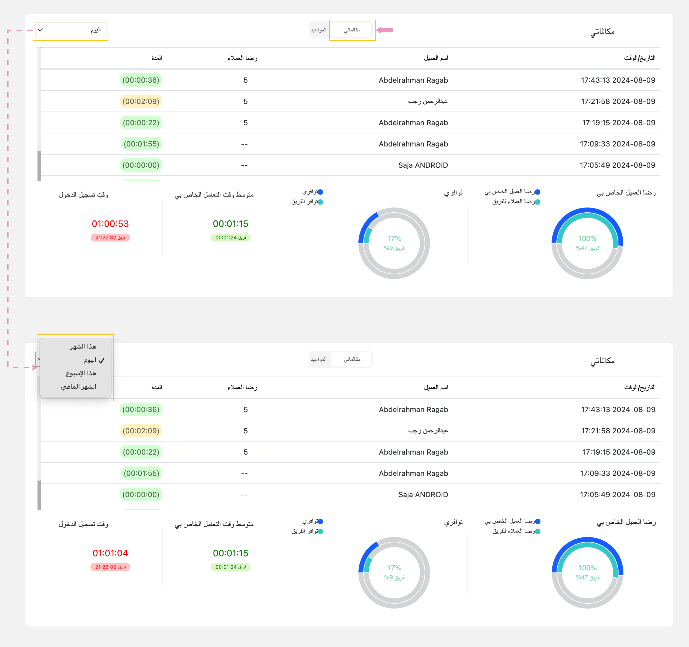

---
tags:
  - مكالماتي
  - سجل المكالمات
  - سجل التفاعلات
  - تفاعلاتي
hide:
  - toc
---
# سجل المكالمات (مكالماتي)

---
تُوفر ميزة سجل التفاعل نظرة شاملة على مكالماتك السابقة مع العملاء ومعرفة رضا العملاء لك.

كيف يمكنني الوصول إلى سجل التفاعل؟

في صفحة "لوحة القيادة"، يمكنك عرض تفاصيل مكالماتك من خلال علامة التويب الخاصة ب "مكالماتي". بحيث تتوفر المعلومات التالية:

| الاسم | الوصف |
| ------------ | --------- |
| التاريخ والوقت | يعرض هذا تاريخ ووقت بدء كل تفاعل. |
| اسم العميل | هذا يعرض الاسم الكامل للعميل. |
| رضا العملاء | هذا يعرض تقييم العميل للمكالمة عبارة عن تقييم من ١ (أقل تقييم) إلي ٥ (أعلى تقييم). |
| المدة | يمثل هذا مدة كل تفاعل. تشير الألوان المختلفة إلى مدد مختلفة: الأخضر لمدة ٠-٢ دقائق، والأصفر لمدة ٢-٤ دقائق، والأحمر لمدة ٤-٦ دقائق. |

!!! tip "تلميح"
    يمكنك تصفية تفاعلاتك السابقة حسب "هذا الشهر" أو "اليوم" أو "هذا الأسبوع" أو "الشهر الماضي".

يمكنك أيضًا عرض إحصائيات المكالمات والرسوم البيانية على النحو التالي:

- رضا العميل الخاص بي (%): يعرض النسبة المئوية لنتيجة رضا العملاء من أصل ١٠٠٪ بناءً على نتائج الاستبيان لك ولفريقك.

- توافري (%): يعرض بيانات عن مدى التوافر  لك ولفريقك. عن طريق حساب النسبة بين إجمالي وقت الاستعداد ووقت العمل لفترات محددة (اليوم، وهذا الأسبوع، وهذا الشهر، والشهر الماضي). يشمل وقت الجاهزية وقت العمل تحت الطلب والوقت المتاح، بينما يشمل وقت العمل أوقات العمل وقت الاستدعاء ووقت التوافر ووقت الاتصال بالإنترنت ووقت عدم الإزعاج وأوقات الراحة.

- متوسط وقت التعامل الخاص بي  (ساعة:دقيقة:ثواني): يعرض متوسط وقت المعالجة لجميع السجلات (المكالمات)، مقيسًا بالساعات والدقائق والثواني، لك ولفريقك.

- وقت تسجيل الدخول (ساعة:دقيقة:ثواني): يعرض إجمالي وقت تسجيل الدخول من لحظة تسجيل الدخول إلى الوقت الحالي لك ولفريقك، مقيسًا بالساعات والدقائق والثواني.

مقالات متعلقة:

- [لوحة القيادة](../Getting-started/My-dashboard.md)
- [جاهز لإستقبال مكالمات](../Getting-started/Getting-ready-for-engagements.md)
