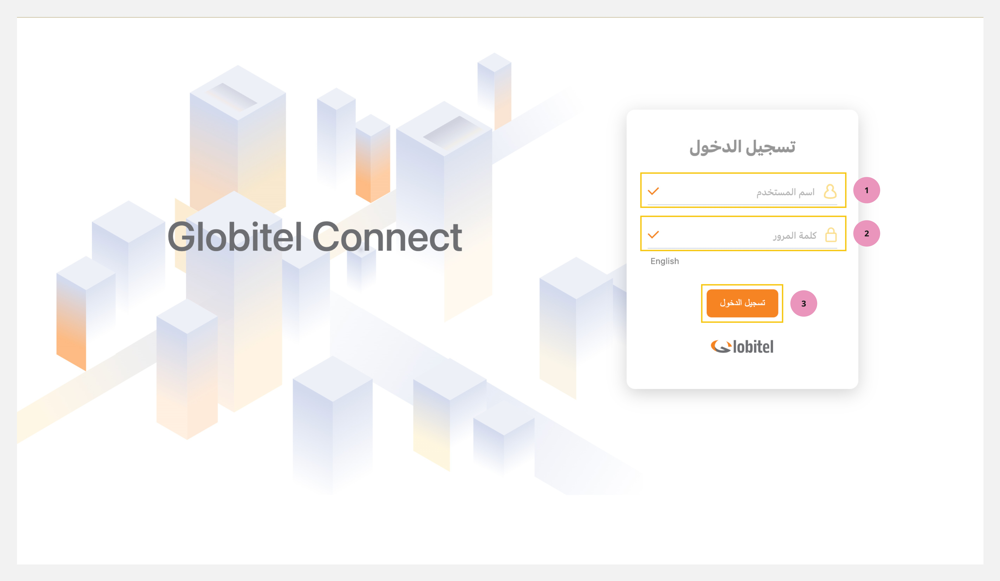

---
hide:
  - toc
tags:
  - تسجيل الدخول
  - البداية
  - الوصول للنظام
---

# تسجيل الدخول

---
تسجيل الدخول هو الخطوة الأولى للوصول إلى جلوبيتل كونكت. ستحدد صلاحياتك مثل موظف خدمة العملاء أو المشرف ميزات النظام والوظائف المتاحة لك.

كيفية الوصول إلى صفحة تسجيل الدخول؟

للوصول إلى نظام جوبيتل كونكت اتبع هذه الخطوات البسيطة:

1. افتح متصفح الويب المفضل لديك. قد يكون جوجل كروم أو فايرفوكس أو مايكروسوفت إيدج أو أوبرا.
2. في شريط العنوان، أدخل عنوان URL الخاص بالخادم بالصيغة التالية: `http://Server_Name:Port/gc-web`. يُرجى التأكد من استبدال "اسم_الخادم" و"المنفذ" بالتفاصيل المحددة التي زودك بها المسؤول لديك.

!!! tip "تلميح"
    متصفح الويب الموصى به لإستخدام نظام جلوبيتل كونيكت هو جوجل كروم (Google Chrome). يمكنك تنزيله من [هذا الرابط](https://www.google.com/chrome/). وهو يدعم جميع أنظمة التشغيل، بما في ذلك ويندوز وماك ولينكس.

كيفية تسجيل الدخول؟

لتسجيل الدخول إلى حسابك على جلوبيتل كونكت، اتبع الخطوات التالية:

1. اكتب اسم المستخدم الخاص بك في حقل `اسم المستخدم`
2. بعد ذلك، أدخل كلمة المرور الخاصة بك في حقل `كلمة المرور`.
3. انقر على زر تسجيل الدخول أو اضغط على زر Enter من لوحة المخاتيح للمتابعة.

!!! tip "تلميح"
    يرجى التأكد من استخدام بيانات الاعتماد الصحيحة المقدمة لك لتسجيل الدخول بنجاح، كما يمكنك تغيير كلمة المرور لحماية حسابك بعد أول تسجيل دخول. [يمكنك الإطلاع على التفاصيل هنا](../My-profile/Change-password.md).

مقالات متعلقة:

- [لوحة التحكم](../Getting-started/My-dashboard.md)
- [إختبار الكاميرا والمايك](../Getting-started/Testing-your-camera-and-microphone.md)
- [جاهز لإستقبال مكالمات](../Getting-started/Getting-ready-for-engagements.md)
- [تغيير كلمة المرور](../My-profile/Change-password.md)
