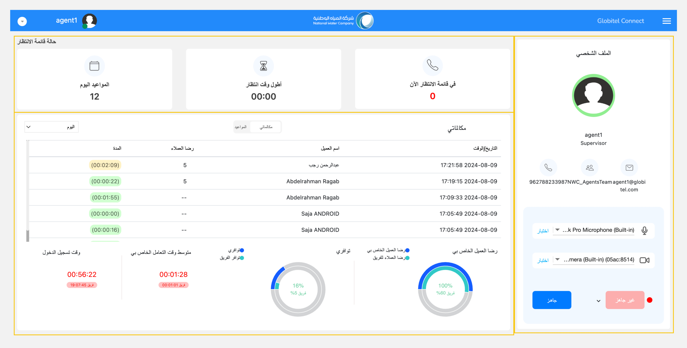
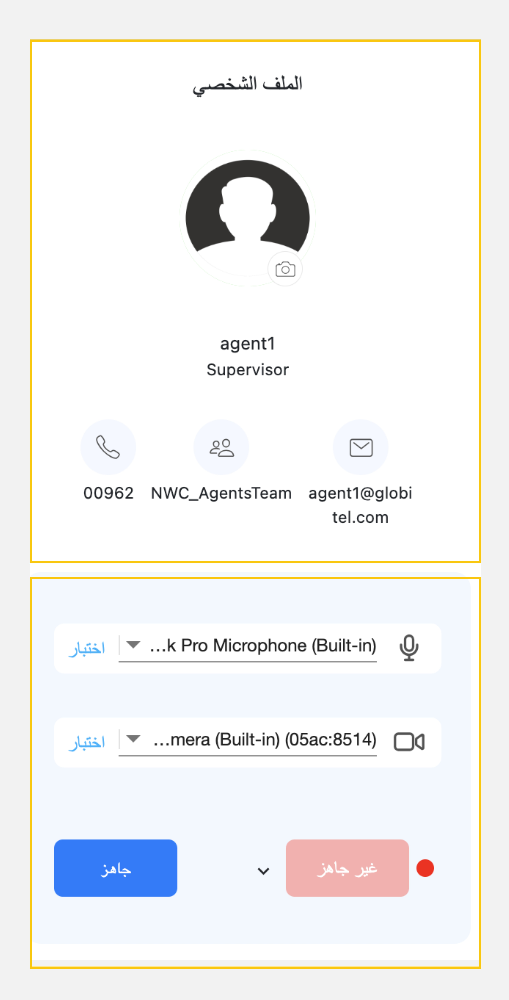

---
tags:
  - لوحة القيادة
  - الرئيسية
  - صفحتي الرئيسية
  - مساحة العمل الخاصة بي
---

# مساحة العمل (لوحة القيادة)

---
هذه هي الشاشة الأولى والإفتراضية التي ستصل إليها بعد [تسجيل الدخول](Login.md) و[مشاركة شاشتك](Share-screen.md). إنها صفحة مساحة العمل الخاصة بك بحيث توفر تفاصيل شاملة حول تفاعلات العملاء وأدائك الخاص والجاهزية لإستقبال تفاعلات جديدة من العملاء. هذا مفيد للغاية لإعطائك نظرة على ما يحدث حولك.

تتكون هذه الشاشة من الأجزاء التالية:

1. بطاقات الإحصائيات (قائمة الانتظار والمواعيد).
2. الملف الشخصي ولوحة الحالة.
3. سجل التفاعل وشبكة المواعيد.

## بطاقات الإحصائيات (حالة قائمة الإنتظار)

هذه بطاقات في الجزء العلوي من شاشة لوحة القيادة تعطيك فكرة عما يحدث مع العملاء في الوقت الحالي. هناك ثلاث بطاقات تعرض لك ما يلي:

- في قائمة الانتظار الآن (#): هذا هو عدد العملاء الذين ينتظرون حاليًا في الإنتظار للرد عليهم.
- أطول وقت انتظار (دقائق:ثواني): يعرض هذا وقت العميل الذي ينتظر أطول فترة انتظار.
- مواعيد اليوم (#): هذا هو العدد الإجمالي لجميع المواعيد مع العملاء لليوم الحالي.

## لوحة الملف الشخصي والحالة

تعرض لوحة الملف الشخصي معلومات ملفك الشخصي، والتي تتضمن:

- صورة الملف الشخصي: صورتك المعروضة أثناء مكالمات العملاء.
- الاسم الكامل: اسمك الكامل المعروض أثناء مكالمات العملاء.
- البريد الإلكتروني: بريدك الإلكتروني المسجل في النظام.
- الفريق: الفريق الذي تنتمي إليه.
- رقم الهاتف: رقم هاتف عملك.

تسمح لك لوحة الحالة بتحديث حالة التوفر الحالية الخاصة بك، وتهيئتك لبدء [إستقبال تفاعلات جديدة](Getting-ready-for-engagements.md) مع العملاء.

## شبكة تاريخ المكالمات والمواعيد

تعرض لك هذه الشبكة تاريخ تفاعلاتك السابقة مع العملاء وجميع المواعيد التي تم حجزها من قبل العملاء للإطلاع عليها.

!!! tip "تلميح"
    إذا كان لديك صلاحية المشرف سوف تتمكن من الإطلاع على جميع سجلات المكالمات (التفاعلات) والمواعيد لكل الفريق.

تغطي علامة التبويب الخاصة [بسجل المكالمات (التفاعلات)](Interaction-history.md) المعلومات التالية:

| الاسم | الوصف |
| ------------ | --------- |
| التاريخ والوقت | هذا يعرض تاريخ ووقت بدء كل تفاعل. |
| اسم العميل | هذا يعرض الاسم الكامل للعميل. |
| رضا العملاء | هذا يعرض تقييم العميل للمكالمة وهو عبارة عن تقييم بين ١ (أقل تقييم) إلي ٥ (أعلى تقييم) وفي حالة عدم التقييم يظهر "--". |
| المدة | يشير هذا إلى مدة كل تفاعل. تشير الألوان إلى فترتي البداية والنهاية. على سبيل المثال، يشير اللون الأخضر إلى ٠ إلى دقيقتين، والأصفر يشير إلى دقيقتين إلى ٤ دقائق، والأحمر إلى ٤ إلى ٦ دقائق. |

تغطي علامة التبويب الخاصة [بسجل المواعيد (الحجوزات)](./Appointments.md) المعلومات التالية:

| الاسم | الوصف |
| ------------ | --------- |
| وقت الموعد | هذا يعرض تاريخ ووقت الموعد الذي تم حجزه من قبل العميل. |
| حالة إكمال المكالمة | هذا يعرض حالة المكالمة إذا كانت قادمة أو تم إكمالها أو أعيدت جدولتها أو تم إلغائها. |

مقالات متعلقة:

- [جاهز لإستقبال مكالمات](../Getting-started/Getting-ready-for-engagements.md)
- [سجل الفاعلات](../Getting-started/Interaction-history.md)
- [الحجوزات](../Getting-started/Appointments.md)
