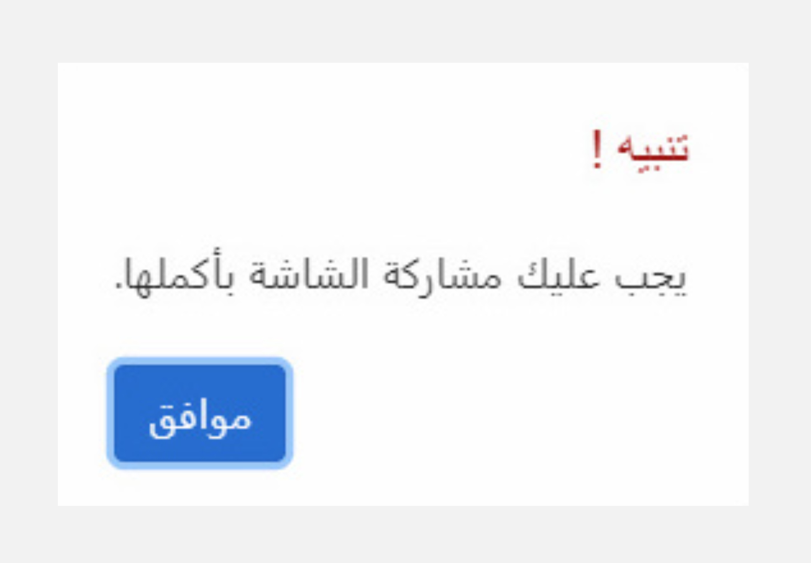
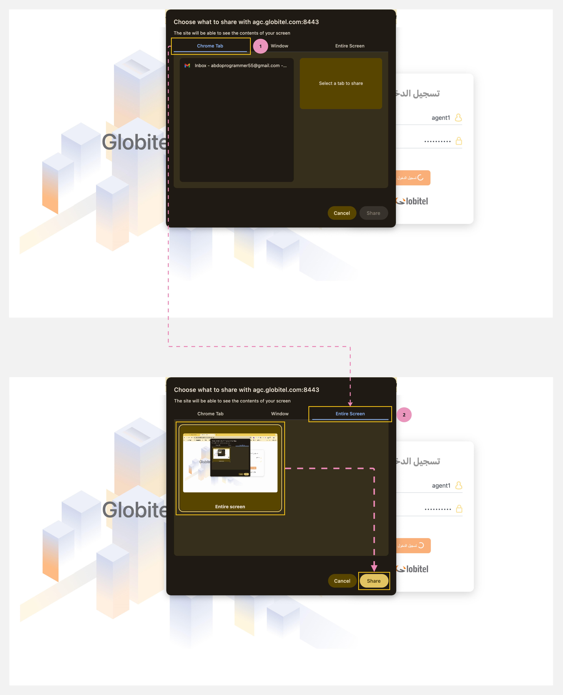

---
tags:
  - البداية
  - مشاركة الشاشة
  - خطوة ضرورية
hide:
  - toc
---

# مشاركة الشاشة (ضرورية)

---

هذه خطوة ضرورية بالنسبة لك لبدء استخدام النظام. ستحتاج إلى مشاركة شاشة متصفحك بالكامل مع النظام بحيث يسجل أنشطة شاشتك لغرض مراقبة الجودة.

!!! warning "تنبيه"
    لن يسمح لك النظام بالمتابعة أو التعامل مع التفاعلات إذا لم تقم بتنفيذ هذه الخطوة.

{ width=250 }

كيف تشارك شاشة المتصفح بالكامل؟

بعد [تسجيل الدخول](Login.md)، سيعرض النظام تلقائيًا نافذة منبثقة، حيث تحتاج إلى اتباع
الخطوات التالية:

1. انقر على علامة التبويب "الشاشة بأكملها - Entire Screen" في النافذة المنبثقة.
2. قم بتحديد شاشة المتصفح بأكملها.
3. أخيرًا، انقر على زر "مشاركة" لبدء مشاركة الشاشة.

!!! tip "تلميح"
    سيقوم النظام بتسجيل جميع أنشطة الشاشة أثناء المكالمة وسيتوقف عن التسجيل بمجرد انتهاء المكالمة.

مقالات متعلقة:

- [إختبار الكاميرا والمايك](../Getting-started/Testing-your-camera-and-microphone.md)
- [جاهز لإستقبال مكالمات](../Getting-started/Getting-ready-for-engagements.md)
