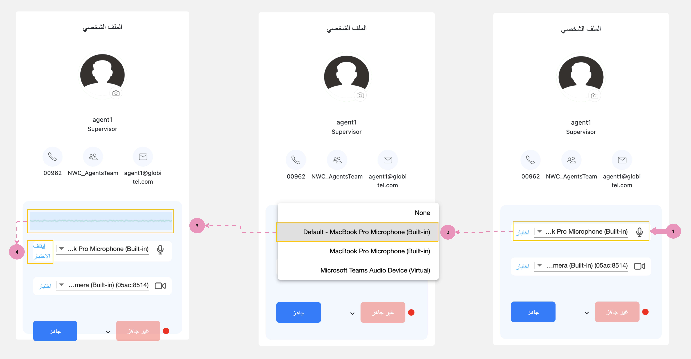
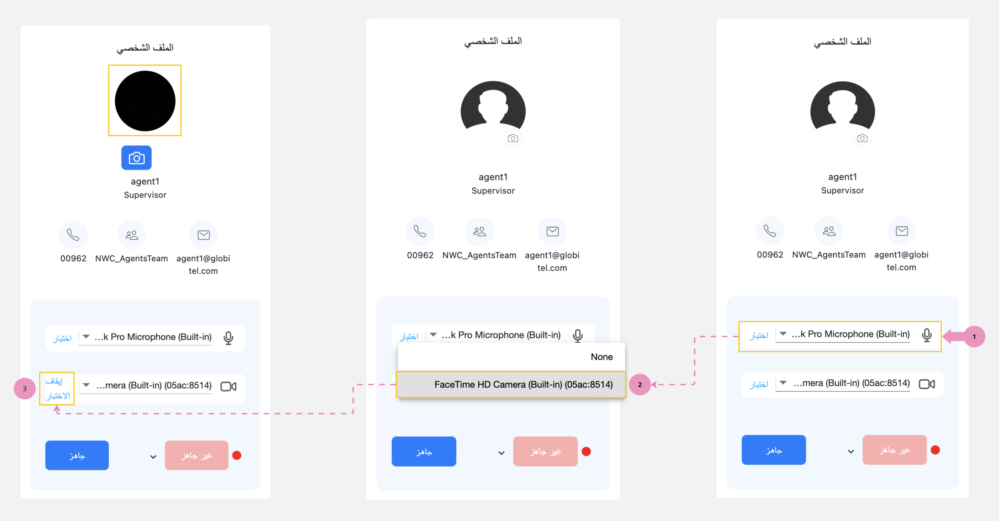

---
tags:
  - إختبار الكاميرا
  - إختبار الميكرفون
  - إختبار المكالمات
---

# إختبار الكاميرا والميكرفون الخاص بي

---
تسمح لك هذه الميزة باختبار الكاميرا والميكروفون المتصلين بالحاسوب والتأكد من أنهم يعملان بالشكل الصحيح قبل التفاعل مع العملاء.

!!! warning "تنبيه"
    يرجى التأكد من أن جهاز الحاسوب الخاص بك يحتوي على كاميرا وميكروفون مضافين أو مدمجين حتى تتمكن من استخدام النظام. بدونهما، لن تتمكن من تلقي التفاعلات.

## اختبار الميكروفون الخاص بي

!!! tip "تلميح"
    يختار النظام الميكروفون المدمج بشكل افتراضي. يمكنك النقر على زر "اختبار" لبدء اختبار هذا الميكروفون.

لاختبار الميكروفون الخارجي، اتبع الخطوات التالية:

1. قم بتوصيل الميكروفون بجهاز الحاسوب الخاص بك.
2. انقر على القائمة المنسدلة بجوار أيقونة الميكروفون في لوحة الملف الشخصي.
3. حدد الميكروفون المخصص الذي تريد اختباره.
4. انقر على زر "اختبار" وابدأ التحدث لعرض تردد صوتك.
5. أخيرًا، انقر على زر "إيقاف الإختبار" لإنهاء الاختبار.

## إختبار الكاميرا الخاصة بي

!!! tip "تلميح"
    يختار النظام الكاميرا المدمجة بشكل افتراضي. يمكنك النقر على زر "اختبار" لبدء اختبار هذه الكاميرا.

لاختبار الكاميرا الخارجية، اتبع الخطوات التالية:

1. قم بتوصيل الكاميرا بالحاسوب.
2. انقر على القائمة المنسدلة بجوار أيقونة الكاميرا في لوحة الملف الشخصي.
3. حدد الكاميرا المخصصة التي تريد اختبارها.
4. انقر على زر "اختبار" لبدء عرض وجهك في صورة الملف الشخصي.
5. أخيرًا، انقر على زر "إيقاف الإختبار" لإنهاء الاختبار.

مقالات متعلقة:

- [جاهز لإستقبال مكالمات](../Getting-started/Getting-ready-for-engagements.md)
