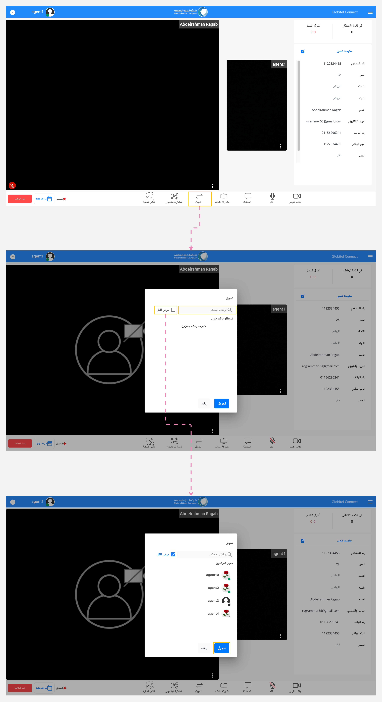

---
tags:
  - تحويل المكالمة
  - المكالمات
hide:
  - toc
---
# تحويل المكالمة

---
تمكّنك هذه الوظيفة من تحويل تفاعلك النشط مع العميل إلى موظف خدمة عملاء آخر جاهز ومتاح للتعامل معه.

كيف يمكنني تحويل المكالمة إلى موظف خدمة عملاء آخر جاهز؟

لتحويل المكالمة، اتبع الخطوات التالية:

1. انقر على زر "تحويل" الموجود في قسم وظائف الاجتماع.
2. ستظهر نافذة منبثقة تعرض موظفين خدمة العملاء المتاحين بشكل افتراضي.
3. يمكنك البحث عن موظف خدمة عملاء معين عن طريق كتابة اسمه في مربع البحث.
4. أخيرًا، حدد موظف خدمة العملاء وانقر على زر "تحويل".

مقالات متعلقة:

- [المحادثة مع العميل](../Handling-Interactions/Chat.md)
- [تبادل الملفات](../Handling-Interactions/Exchanging-documents.md)