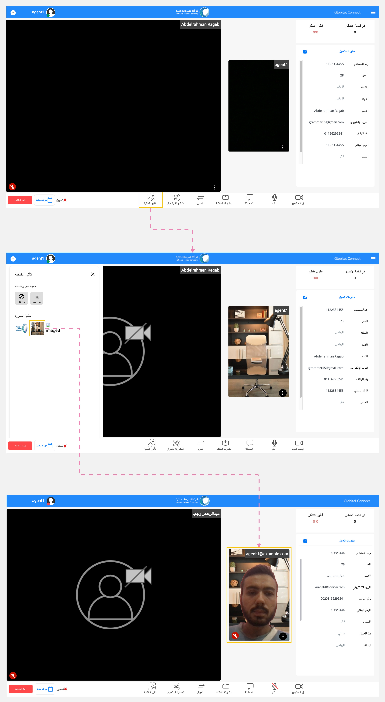
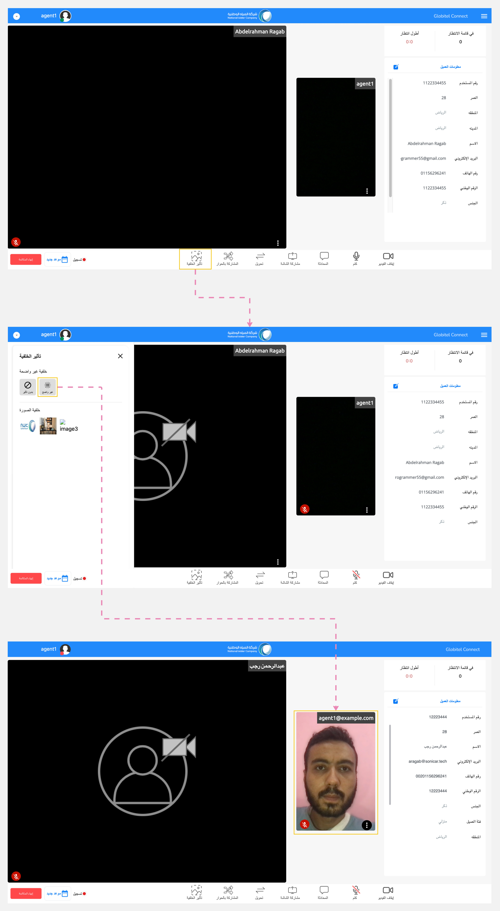

---
tags:
  - تغيير الخلفية
  - إضافة تأثير
---
# تغيير خلفية الكاميرا

---
أثناء استخدام الكاميرا، يمكنك الاستفادة من هذه الميزة لتغيير الخلفية أو إجراء تأثير عليها أثناء تفاعلات مع العملاء.

!!! warning "تنبيه"
    استخدم هذه الوظيفة فقط عند استخدام الكاميرا مع أحد العملاء.

## كيفية تغيير صورة الخلفية؟

اتبع هذه الخطوات لتغيير صورة الخلفية:

1. انقر على زر "تأثير الخلفية" الموجود في قسم الوظائف في غرفة الإجتماع.
2. ستظهر لوحة "تأثير الخلفية".
3. حدد صورة الخلفية المفضلة لديك من قسم "خلفية الصورة".
4. أخيرًا، يمكنك رؤية هذا التأثير في قسم "الاجتماع" وسيرى العميل هذه الخلفية أثناء التفاعل معك.

## كيفية تطبيق تأثير التمويه على الخلفية؟

اتبع هذه الخطوات لتطبيق تأثير ضبابي على الخلفية:

1. انقر على زر "تأثير الخلفية" الموجود في قسم الوظائف في غرفة الاجتماعات.
2. ستظهر لوحة "تأثير الخلفية".
3. حدد "ضبابية - غير واضح" من قسم "خلفية غير واضحة".
4. أخيرًا، يمكنك رؤية هذا التأثير في قسم "الاجتماع" وسيرى العميل هذه الخلفية أثناء التفاعل معك.

!!! tip "تلميح"
    يمكنك إزالة صورة الخلفية أو التأثير الضبابي عن طريق تحديد "بدون تأثير" من لوحة "خلفية غير واضحة".

مقالات متعلقة:

- [وظائف الإجتماع](../Handling-Interactions/Conference-room-functions.md)
- [المحادثة مع العميل](../Handling-Interactions/Chat.md)
- [تبادل الملفات](../Handling-Interactions/Exchanging-documents.md)