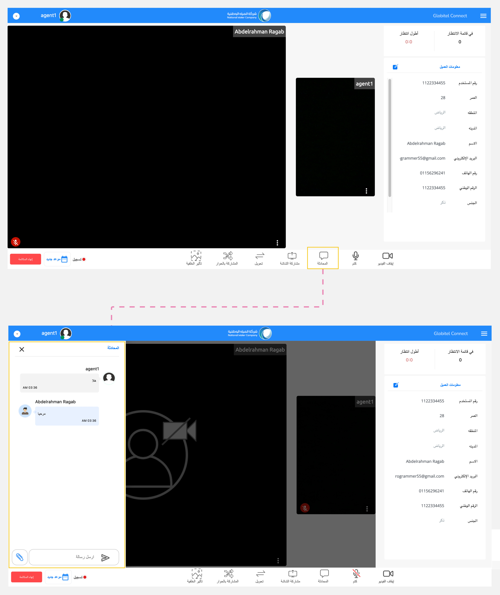

---
tags:
  - المحادثات
  - الرسائل
  - الشات
  - المحادثة
hide:
  - toc
---
# المحادثة

---
تتيح لك ميزة المحادثة تبادل الرسائل النصية مع العملاء أثناء التفاعل. هذه الميزة مفيدة بشكل خاص عندما تحتاج إلى مشاركة تفاصيل مثل الأرقام أو العناوين التي تتطلب الحفظ. كما أنها مفيدة أيضاً عندما يكون الاتصال بالإنترنت ضعيفاً وتحتاج إلى إرسال معلومات مهمة.

كيف يمكنني المحادثة مع العميل؟

يمكنك المحادثة مع العميل باتباع الخطوات التالية:

1. انقر على أيقونة "المحادثة" الموجودة في قسم وظائف الإجتماع.
2. سيظهر قسم المحادثة، حيث يمكنك عرض رسائل العميل.
3. لإرسال رسالة، اكتبها في مربع الرسالة واضغط على زر "Enter".

!!! warning "تنبيه"
    إذا كانت لديك معلومات مهمة تتعلق بتفاعل ما، قم بنسخها قبل انتهاء المكالمة وإلا ستفقد البيانات من المحادثة عند انتهاء المكالمة.

مقالات متعلقة:

- [وظائف الإجتماع](../Handling-Interactions/Conference-room-functions.md)