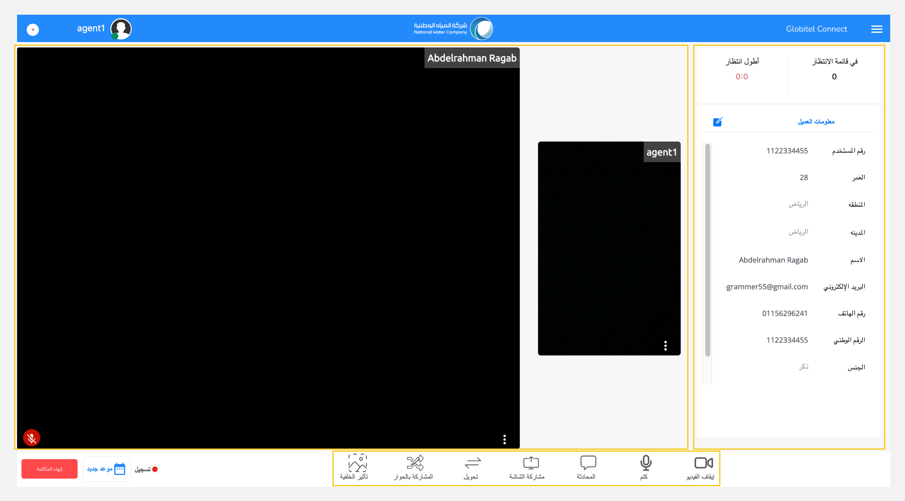
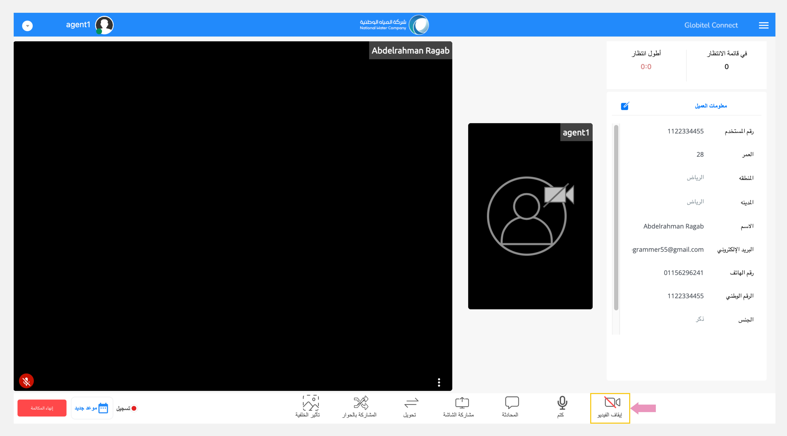
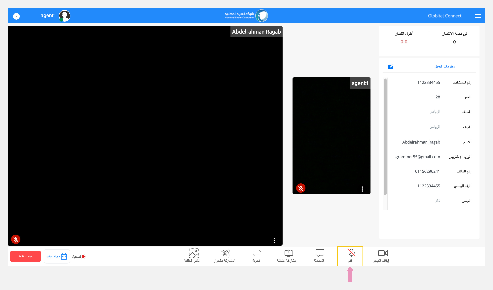
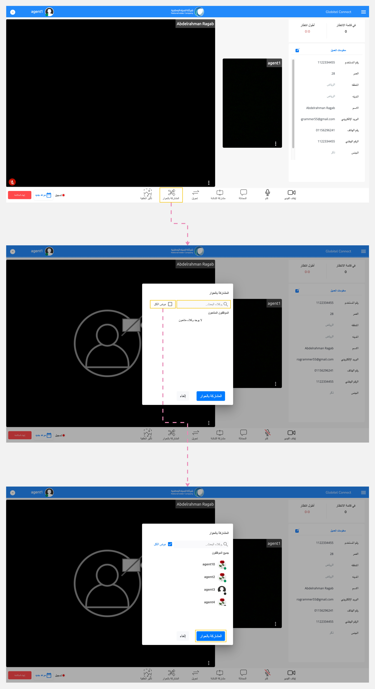

---
tags:
  - التحكم في الإجتماع
  - إدارة الإجتماع
  - وظائف الإجتماع
---
# وظائف غرفة الإجتماع

---
بمجرد أن [تجيب على المكالمة](Receiving-a-new-interaction.md)، ستظهر غرفة الإجتماع، مما يتيح التفاعل مع العميل كما ستتمكن من الإطلاع على صورة العميل وسماع صوته.

تنقسم صفحة غرفة الإجتماع إلى ثلاثة أقسام رئيسية:

1. لوحة الاجتماع: يعرض هذا القسم صورتك وصورة العميل المباشرة وحالة الميكروفون الخاصة بالعميل وحالة الميكروفون الخاصة بك.
2. لوحة معلومات العميل: يعرض هذا القسم جميع معلومات العميل الذي قام بإضافتها قبل حجز الإجتماع.
3. وظائف الإجتماع: يوفر هذا القسم الإجراءات الضرورية التي يمكنك القيام بها أثناء الاجتماع.

## وظائف الإجتماع

فيما يلي ثماني وظائف يمكنك الاستفادة منها أثناء التفاعل مع العميل في الإجتماع:

1. تشغيل/إيقاف تشغيل الكاميرا.
2. كتم/إلغاء كتم صوت الميكروفون.
3. [مشاركة شاشتك](Screen-sharing.md) مع العميل.
4. [تحويل المكالمة](Call-Transfer.md) إلى موظف خدمة عملاء آخر جاهز.
5. بدأ مكالمة جماعية مع المشرف.
6. [تغيير الخلفية](Change-background-and-blur.md) أثناء مشاركة الكاميرا.
7. [المحادثة](Chat.md) مع العميل عن طريق الرسائل النصية.
8. [تبادل المستندات والملفات](Exchanging-documents.md) مع العميل.

### تشغيل/إيقاف تشغيل الكاميرا

لتشغيل الكاميرا أو إيقافها أثناء تفاعل العملاء، انقر على أيقونة "الكاميرا" لإيقافها إذا كانت تعمل أو الضغط عليها لتفعيلها إذا كانت لا تعمل. يمكنك العثور على هذا في قسم وظائف الإجتماع الموجود في أسفل صفحة غرفة الإجتماع.

### كتم/إلغاء كتم صوت الميكروفون الخاص بك

لتبديل كتم صوت ميكروفونك أو إلغاء كتمه أثناء التفاعل مع العميل، انقر على أيقونة "ميكروفون". يمكنك العثور على هذا في قسم وظائف الإجتماع، الموجود في أسفل صفحة غرفة الإجتماع.

!!! warning "تنبيه"
    لا تكتم صوت الميكروفون أثناء التفاعل مع العميل. يمكنك كتم الصوت فقط إذا كان عملك لا يتطلب التحدث مع العميل.

### بدء مكالمة جماعية مع المشرف

يمكنك إنشاء مكالمة جماعية مع مشرف جاهز بالنقر على إجراء "المشاركة بالحوار". سيظهر المشرف الجاهز، أو يمكنك البحث عنه بالاسم لإضافته إلى الاجتماع.

