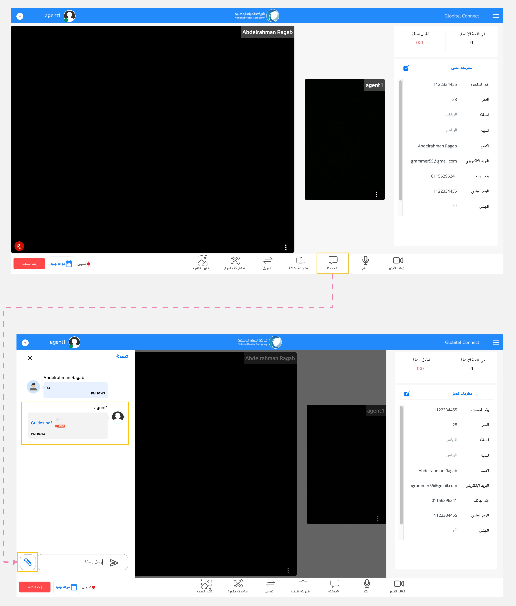

---
tags:
  - مشاركة الملفات
  - إرسال ملف
  - تبادل المستندات
hide:
  - toc
---
# تبادل المستندات والملفات

---
تتيح لك ميزة مشاركة المستندات والملفات مع العملاء أثناء التفاعل. هذه الميزة مفيدة بشكل خاص عندما تحتاج إلى مشاركة مستندات مثل الفواتير.

كيف يمكنني مشاركة المستندات مع العميل؟

يمكنك مشاركة المستندات مع العميل عن طريق الخطوات التالية:

1. انقر على أيقونة "المحادثة" الموجودة في قسم وظائف الإجتماع.
2. سيظهر بعد ذلك قسم الدردشة، حيث يمكنك عرض الرسائل الواردة من العميل.
3. انقر على أيقونة "ملف".
4. سيتم فتح مدير الملفات لتتمكن من تحديد الملف.
5. حدد الملف المحدد الذي تريد مشاركته واضغط على زر "Enter" لإرساله إلى العميل.

!!! warning "تنبيه"
    إذا كانت لديك ملفات مهمة متعلقة بتفاعل ما، قم بتنزيلها قبل انتهاء المكالمة وإلا ستفقد الملفات من الدردشة عند انتهاء المكالمة.

!!! tip "تلميح"
    تشمل أنواع الملفات المدعومة الصور ومقاطع الفيديو والمستندات (PDF، Docx، XLSX) والملفات المضغوطة.

مقالات متعلقة:

- [وظائف الإجتماع](../Handling-Interactions/Conference-room-functions.md)
- [مشاركة الشاشة](../Handling-Interactions/Screen-sharing.md)