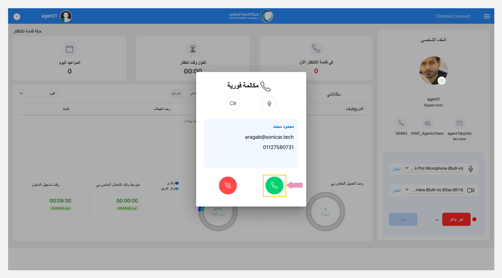
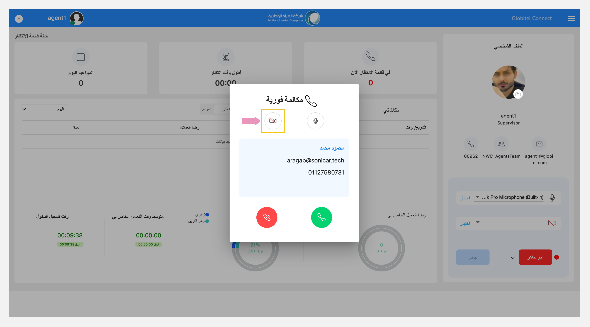
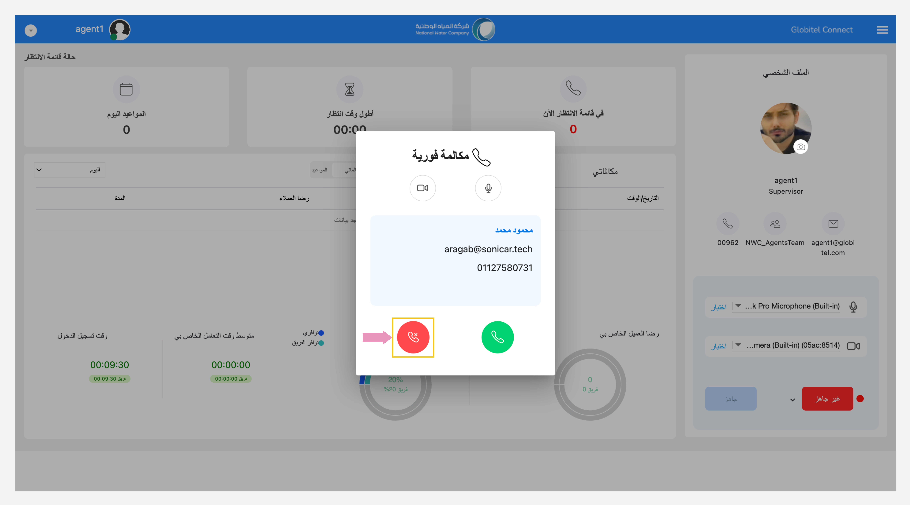

---
tags:
  - المكالمات
  - المكالمات القادمة
  - قبول المكالمة
  - رفض المكالمة
---
# إستقبال مكالمة جديدة

---
إذا كنت [جاهزًا](../Getting-started/Getting-ready-for-engagements.md)، سيبدأ النظام في إرسال تفاعلات العملاء إليك للتعامل معها.

عندما يتم تخصيص تفاعل جديد لك، ستظهر نافذة تنبيه على شاشتك مصحوبة بنغمة رنين.

توفر نافذة الإشعارات هذه التفاصيل التالية:

- ما إذا كانت المكالمة لموعد جديد أو تفاعل دعم فوري.
- خيارات لتمكين الكاميرا أو تعطيلها.
- معلومات العميل، بما في ذلك اسم العميل وبريده الإلكتروني ورقم هاتفه.
- خيارات للرد على هذا التفاعل أو رفضه.

## الرد على المكالمة

اضغط على أيقونة "رد :material-phone:" الخضراء لقبول المكالمة وبدء التفاعل مع العميل.

!!! warning "تنبيه"
    تأكد من تفعيل صوت الميكروفون وتشغيل الكاميرا (إذا تطلب الأمر) عند الرد على المكالمة.

## رفض المكالمة

لرفض المكالمة، اضغط على أيقونة "رفض :material-phone-remove-outline:" الحمراء.

!!! warning "تنبيه"
    إذا لم ترد على تفاعل وارد في غضون ٥ ثوانٍ، فسيقوم النظام بتعيين هذا التفاعل إلى عضو آخر جاهز في الفريق وتعيين حالتك إلى "غير جاهز".
    إذا ضغطت على "رفض"، فسيتم إعادة التفاعل إلى قائمة الانتظار، وسيتم تسجيل رفضك للمكالمة في النظام. يجب استخدام هذا الخيار في حالات الطوارئ فقط.

مقالات متعلقة:

- [إختبار الكاميرا الميكروفون](../Getting-started/Testing-your-camera-and-microphone.md)
- [تحويل المكالمة](../Handling-Interactions/Call-Transfer.md)
- [تغيير الخلفية](../Handling-Interactions/Change-background-and-blur.md)
- [المحادثات/ الدردشة](../Handling-Interactions/Chat.md)
- [تبادل الملفات](../Handling-Interactions/Exchanging-documents.md)
