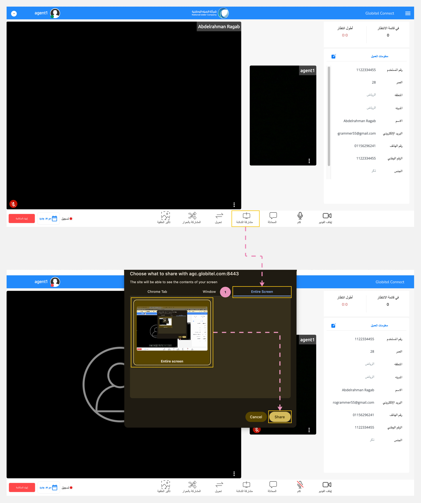

---
tags:
  - مشاركة الشاشة
  - تفعيل الشاشة
hide:
  - toc
---
# مشاركة الشاشة أثناء المكالمة

---
أثناء تفاعلات العملاء، يمكنك مشاركة شاشتك مع العميل لتقديم المعلومات الضرورية أو شرح كيفية استخدام الخدمات التي تتطلب مشاركة الشاشة.

كيف يمكنني مشاركة شاشتي مع العميل؟

الأمر بسيط، ما عليك سوى اتباع الخطوات التالية:

1. انقر على زر "مشاركة الشاشة" الموجود في قسم وظائف الاجتماع.
2. في النافذة المنبثقة، اختر علامة التبويب المطلوبة، مثل علامة تبويب كروم أو النافذة أو الشاشة بأكملها.
3. ثم، حدد الشاشة التي تريد مشاركتها.
4. أخيرًا، ابدأ مشاركة الشاشة بالنقر على زر "مشاركة".

!!! tip "تلميح"
    لإيقاف مشاركة الشاشة، ما عليك سوى النقر على زر "إيقاف مشاركة الشاشة" الموجود في قسم وظائف الاجتماع.

مقالات متعلقة:

- [وظائف الإجتماع](../Handling-Interactions/Conference-room-functions.md)
- [تبادل الملفات](../Handling-Interactions/Exchanging-documents.md)