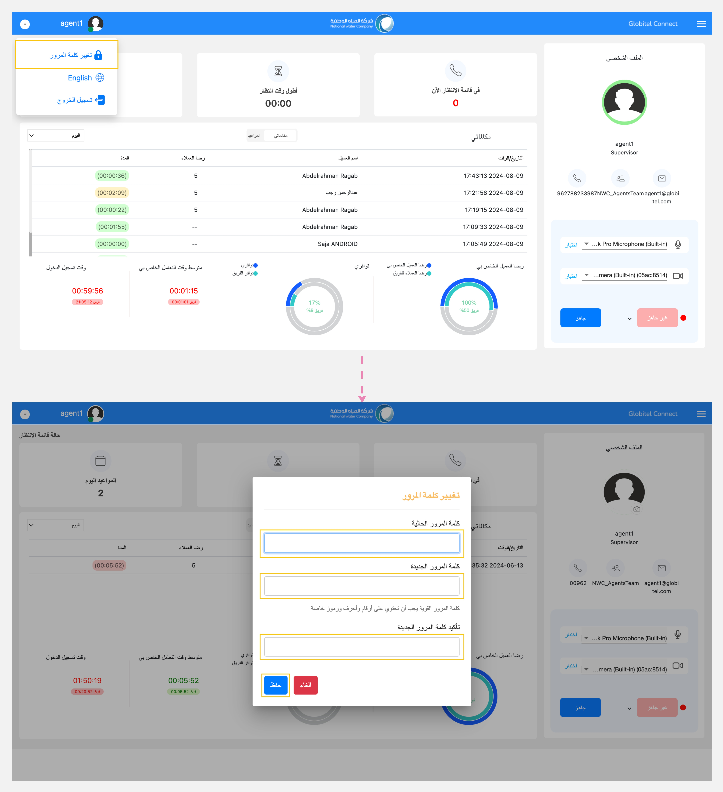

---
tags:
  - تحديث كلمة المرور
  - حماية الحساب
hide:
  - toc
---
# تغيير كلمة المرور

---
يمكنك تغيير كلمة مرورك الحالية لتأمين حسابك أو إذا كنت تقوم بتسجيل الدخول إلى النظام للمرة الأولى وتحتاج إلى تغيير كلمة المرور المتوفرة.

كيف يمكنني تغيير كلمة المرور الحالية؟

لتغيير كلمة المرور الخاصة بك، اتبع الخطوات التالية:

1. انقر على القائمة المنسدلة بالقرب من صورة ملفك الشخصي في رأس الصفحة.
2. اختر "تغيير كلمة المرور" من القائمة المنسدلة.
3. ستظهر نافذة منبثقة لتغيير كلمة المرور الخاصة بك.
4. أدخل كلمة المرور الحالية في حقل "كلمة المرور الحالية".
5. أخيرًا، أدخل كلمة المرور الجديدة وقم بتأكيدها وانقر على "حفظ".

!!! tip "تلميح"
    تأكد من إنشاء كلمة مرور قوية تحتوي على ثمانية أحرف على الأقل. يجب أن تتضمن على الأقل رقمًا واحدًا، وحرفًا خاصًا واحدًا، وحرفًا كبيرًا واحدًا، وحرفًا صغيرًا واحدًا.

مقالات متعلقة:

- [لوحة القيادة (مساحة العمل الخاصة بي)](../Getting-started/My-dashboard.md)
