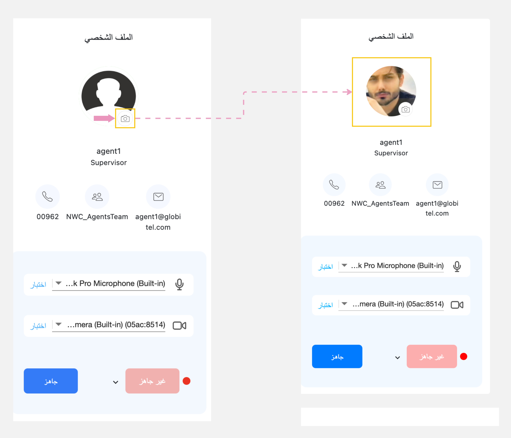

---
tags:
  - تحديث صورتي الشخصية
  - تغيير صورة حسابي
hide:
  - toc
---
# تغيير صورة الملف الشخصي

---
يمكنك إضافة صورة شخصية وذلك من خلال قسم الملف الشخصي الموجود داخل مساحة العمل الخاصة بك عن طريق الضغط علي أيقونة الكاميرا الموجودة بجانب الصورة الإفتراضية ليتم تشغيل الكاميرا والتقاط صورة شخصية بحيث تظهر للعملاء عند التفاعل معهم.

مقالات متعلقة:

- [لوحة القيادة (مساحة العمل الخاصة بي)](../Getting-started/My-dashboard.md)
- [إختبار الكاميرا والميكرفون](../Getting-started/Testing-your-camera-and-microphone.md)
- [جاهز لإستقبال مكالمات](../Getting-started/Getting-ready-for-engagements.md)
