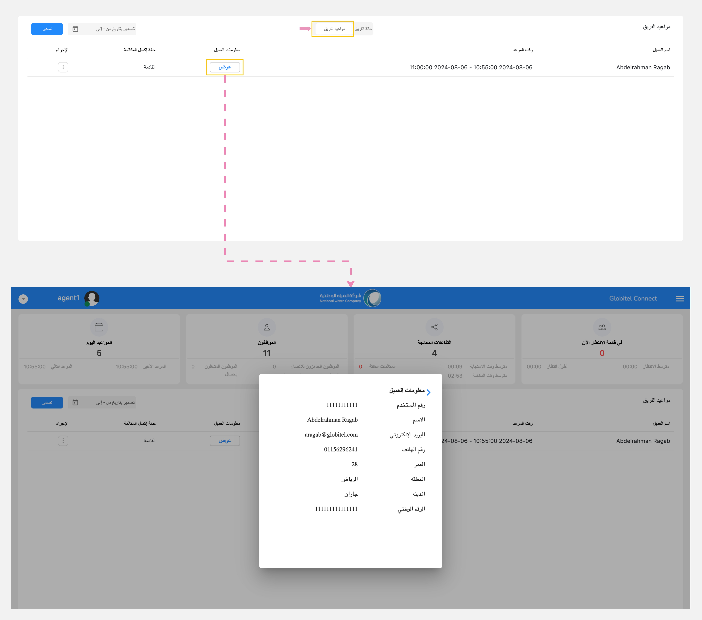
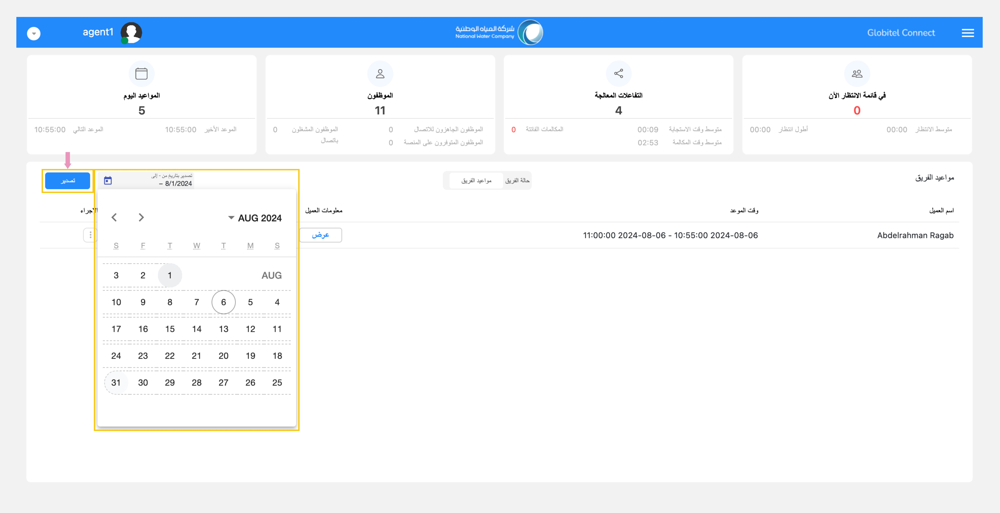

---
tags:
  - تتبع الفريق
  - مراقبة الفريق
  - حالة الفريق الحالية
  - مواعيد الفريق
  - إتخاذ إجراءات
  - تصدير المواعيد
---
# تتبع تفاعلات ومواعيد الفريق

---
تسمح لك هذه الميزة بمراقبة جميع تفاعلات ومواعيد الفريق الخاص بك وتنقسم إلى قسمين هما:

- حالة الفريق: تقدم لك معرفة حالة تواجد الفريق وإحصائيات حول رضا العملاء وعدد المكالمات التي تمت معالجتها لكل موظف.
- مواعيد الفريق: تقدم قائمة بجميع المواعيد التي تم حجزها من قبل العملاء ومعرفة الحالة الحالية لكل موعد.

## حالة الفريق

يسمح قسم "حالة الفريق" للمشرفين بتتبع تفاعلات كل عضو من أعضاء الفريق (موظف خدمة العملاء) في الوقت الفعلي.

!!! tip "تلميح"
    يمكنك تصفية تفاعلات فريقك حسب "هذا الشهر" أو "اليوم" أو "هذا الأسبوع" أو "الشهر الماضي".

جدول حالة الفريق يشمل المعلومات التالية:

| الاسم | الوصف |
| ------------ | --------- |
| اسم موظف خدمة العملاء | هذا هو الاسم الكامل للوكيل، بصيغة: الاسم الأول، اسم العائلة. |
| الحالة الحالية | يُظهر هذا حالة موظف خدمة العملاء في الوقت الفعلي والوقت، مع الإشارة إلى ما إذا كان متصلاً بالإنترنت أو جاهزًا للمكالمات أو في مكالمة حاليًا أو غير متصل. |
| وقت تسجيل الدخول | هذا يعرض تاريخ ووقت تسجيل دخول موظف خدمة العملاء إلى النظام. |
| معالجة | هذا هو إجمالي عدد المكالمات التي تعامل معها موظف خدمة العملاء. |
| متوسط وقت المكالمة (ثانية) | هذا هو "متوسط وقت معالجة المكالمات" للوكيل بالثواني. |
| رضا العملاء | يعرض هذا تقييم العميل بناءً على نتائج استبيان التقييم بعد التفاعل، وهو تقييم من 1 (أدنى تقييم) إلى 5 (أعلى تقييم). |

!!! tip "تلميح"
    تشير الألوان الموجودة في الحالة الحالية إلى فترتي البداية والنهاية. حيث يشير اللون الأخضر إلى 0 إلى دقيقتين، والأصفر يشير إلى دقيقتين إلى 4 دقائق، والأحمر إلى 4 إلى أعلى.

يمكنك أيضًا الإطلاع على إحصائيات ورسوم بيانية للتفاعلات الخاصة بالفريق على النحو التالي:

- رضا العملاء للفريق (%): يعرض النسبة المئوية لنتيجة رضا العملاء من أصل ١٠٠٪ بناءً على نتائج الاستبيان لكامل الفريق.

- توافر الفريق (%): يعرض بيانات عن  نسبة مدى التوافر لفريقك. عن طريق حساب النسبة بين إجمالي وقت الاستعداد ووقت العمل لفترات محددة (اليوم، وهذا الأسبوع، وهذا الشهر، والشهر الماضي). يشمل وقت الجاهزية وقت العمل تحت الطلب والوقت المتاح، بينما يشمل وقت العمل أوقات العمل وقت الاستدعاء ووقت التوافر ووقت الاتصال بالإنترنت ووقت عدم الإزعاج وأوقات الراحة.

- متوسط وقت المكالمات للفريق  (ساعة:دقيقة:ثواني): يعرض متوسط وقت المعالجة لجميع السجلات (المكالمات) لفريقك، مقيسًا بالساعات والدقائق والثواني.

- وقت الدخول للفريق (ساعة:دقيقة:ثواني): يعرض إجمالي وقت تسجيل الدخول من لحظة تسجيل الدخول إلى الوقت الحالي لفريقك، مقيسًا بالساعات والدقائق والثواني.

### ما هي الإجراءات التي يمكنني اتخاذها لمراقبة التفاعل الحالي (أيقونة ٣ نقاط - :material-dots-horizontal-circle:)؟

{ width=200, align=left }

في قسم "حالة الفريق"، يمكن للمشرفين تنفيذ بعض الإجراءات من خلال النقر على أيقونة الـ ٣ نقاط (:material-dots-horizontal-circle:). تتوافر إجراءات مثل "الاستماع" أو "الهمس" أو "دخول فوري" أثناء التفاعل النشط.

- الاستماع: تسمح هذه الميزة للمشرف بالاستماع بصمت إلى مكالمة تم إجراؤها أو الرد عليها من قبل موظف خدمة العملاء. يمكن أن يساعد ذلك في تقييم أداء موظف خدمة العملاء وفهم تفاعلات العملاء.
- الهمس: تتيح هذه الميزة للمشرف تقديم المشورة والتوجيه المباشر للوكيل أثناء المكالمة. يتم إلغاء كتم صوت خط المسؤول، ولكن يتم توصيل الصوت إلى موظف خدمة العملاء فقط، وبالتالي عدم مقاطعة المكالمة.
- الدخول الفوري: تتيح هذه الميزة للمشرفين الانضمام إلى مكالمة مباشرة، مما يجعلها محادثة ثلاثية. هذا مفيد بشكل خاص في المواقف التي قد يحتاج فيها موظف خدمة العملاء إلى المساعدة في التعامل مع مكالمة صعبة.

## مواعيد الفريق

يسمح قسم "مواعيد الفريق" للمشرفين بتتبع جميع المواعيد داخل المنظمة (جميع مواعيد العملاء) في الوقت الفعلي.

جدول مواعيد الفريق يشمل المعلومات التالية:

| الاسم | الوصف |
| ------------ | --------- |
| اسم العميل | هذا هو الاسم الكامل للعميل، بصيغة: الاسم الأول، اسم العائلة. |
| وقت الموعد | هذا يعرض تاريخ ووقت الموعد الذي تم حجزه من قبل العميل. |
| معلومات العميل | هذا يعرض تفاصيل ومعلومات العميل بالكامل. |
| حالة إكمال المكالمة | هذا يعرض حالة المكالمة إذا كانت قادمة أو تم إكمالها أو أعيدت جدولتها أو تم إلغائها. |
| إجراءات (أيقونة ٣ نقاط - :material-dots-horizontal-circle:) | يمكنك إتخاذ بعض الإجراءات مثل إلغاء الموعد مع توضيح السبب. |

!!! tip "تلميح"
    يمكنك كمشرف تصدير المواعيد عن طريق تحديد تواريخ البدء والانتهاء، ثم النقر فوق تصدير لتحميل مواعيد الفريق كملف Excel.

### ما هي الإجراءات التي يمكنني اتخاذها لإدارة المواعيد (أيقونة ٣ نقاط - :material-dots-horizontal-circle:)؟

{ width=100, align=left }
في قسم "مواعيد الفريق"، يمكن للمشرفين تنفيذ إجراء "إلغاء" الموعد المحدد عن  طريق إختيار الموعد ثم إختيار إلغاء وتأكيد الإجراء.

مقالات متعلقة:

- [لوحة القيادة (مساحة العمل الخاصة بي)](../Getting-started/My-dashboard.md)
