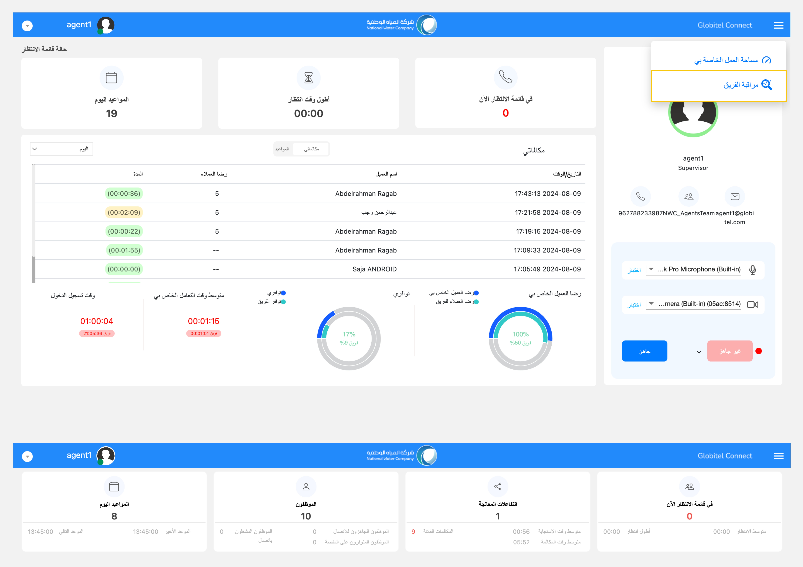

---
tags:
  - تتبع الفريق
  - مراقبة الفريق
  - مراقبة الأداء
  - إحصائيات الفريق
---
# تتبع أداء موظفي خدمة العملاء

---
بصفتك مشرفاً، يمكنك الإشراف على أداء فريقك والوصول إلى تحليل إحصائي مفصل لحالات موظفي خدمة العملاء.

كيف يمكنني الوصول إلى صفحة مراقبة الفريق؟

للوصول إلى صفحة مراقبة الفريق، اتبع الخطوات التالية:

1. انقر على أيقونة الخيارات على الجانب الأيمن من رأس الصفحة.
2. من القائمة المنسدلة، اختر "مراقبة الفريق".
3. ستظهر لك صفحة مراقبة الفريق.

هناك أربع بطاقات في صفحة مراقبة الفريق، موضحة على النحو التالي:

## حالة قائمة الإنتظار

تزود بطاقة "في قائمة الانتظار الآن" المشرفين بإحصائيات في الوقت الفعلي عن العملاء لليوم الحالي:

- في قائمة الانتظار الآن (#): تعرض العدد الإجمالي للعملاء الموجودين حاليًا في قائمة الانتظار الافتراضية في انتظار تفاعل موظف خدمة العملاء.
- متوسط الانتظار (دقيقة:ثانية): يعرض متوسط وقت الانتظار للعملاء الذين ينتظرون عادةً أكثر من متوسط وقت الانتظار المقبول، وهو الوقت الذي تم ضبطه من قِبل المسؤول (الوقت الافتراضي هو 10 دقائق).
- أطول انتظار (دقيقة:ثانية): يشير إلى وقت انتظار العميل الذي انتظر أطول فترة انتظار.

## التفاعلات المعالجة

ضمن بطاقة "التفاعلات المعالجة"، يمكن للمشرفين عرض الإحصائيات التالية في الوقت الفعلي حول المكالمات التي تمت معالجتها لليوم الحالي:

- التفاعلات المعالجة (#): يمثل هذا العدد الإجمالي للمكالمات التي تم الرد عليها من قبل موظفين خدمة العملاء، ولا يشمل المكالمات الفائتة.
- متوسط وقت الاستجابة (دقيقة:ثانية): يوضح متوسط الوقت المستغرق لبداية الرد على مكالمات العملاء.
- متوسط وقت المكالمة (دقيقة:ثانية): يمثل متوسط مدة المكالمات التي يديرها (يتفاعل معها) موظفين خدمة العملاء.
- المكالمات الفائتة (#): يعرض هذا العدد الإجمالي للمكالمات التي تركها العملاء.

## الفريق (موظفو خدمة العملاء)

تمكّن بطاقة "الموظفون" المشرفين من عرض الإحصائيات التالية في الوقت الفعلي حول موظفين خدمة العملاء لليوم الحالي:

- الموظفون (#): يعرض هذا العدد الإجمالي لموظفين خدمة العملاء داخل الفريق.
- الموظفون الجاهزون للإتصال (#): يمثل هذا العدد الإجمالي لموظفين خدمة العملاء الجاهزين لتلقي مكالمات العملاء.
- الموظفون المتوفرون على المنصة (#): يشير هذا إلى إجمالي عدد موظفين خدمة العملاء النشطين والمتوفرين حالياً داخل النظام.
- الموظفون المشغولون (#): يشير هذا إلى إجمالي عدد موظفين خدمة العملاء المشغولين حالياً بمكالمات العملاء.

## المواعيد اليوم

ضمن بطاقة "المواعيد اليوم"، يمكن للمشرفين عرض الإحصائيات التالية في الوقت الفعلي حول المواعيد الأخيرة والتالية لليوم الحالي:

- المواعيد اليوم (#): يمثل هذا العدد الإجمالي لجميع المواعيد في الوقت الحالي.
- الموعد الأخير : يشير هذا إلى الفترة الزمنية المخصصة لآخر موعد في اليوم.
- الموعد التالي: يمثل ذلك الفترة الزمنية المخصصة للموعد القادم التالي.

مقالات متعلقة:

- [لوحة القيادة (مساحة العمل الخاصة بي)](../Getting-started/My-dashboard.md)
