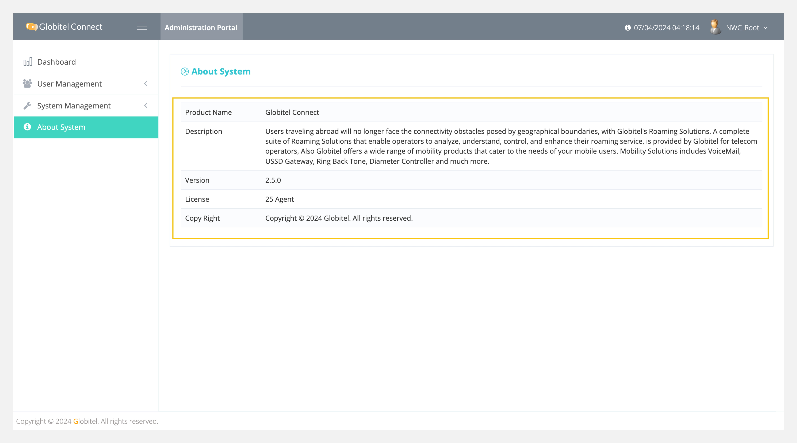

---
tags:
  - About System
  - My License
  - About Globitel Connect
hide:
  - toc
---
# About System

---
Under the About System page, you can find system information such as product name, description, current version, and license. The license information is helpful for providing the maximum number of allowed agent users on your subscription.

You can access the About System page by selecting "About System" from the left-side menu to view license information.

Related Articles:

- [Dashboard](./My-Dashboard.md)
- [Roles Management](./User-Management/Roles-Management.md)
- [System Settings](./System-Management/System-Settings.md)
