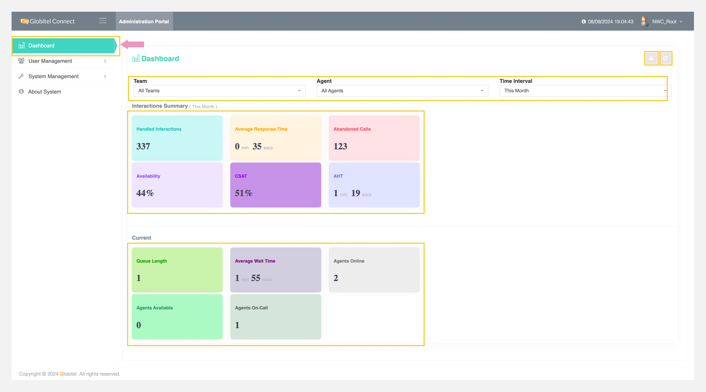

---
tags:
  - My Dashboard
  - Home
  - Landing Page
  - Dashboard
---

# My Dashboard

---

This is the first screen you will access after [logging in](./log-in.md). It's a landing page that provides comprehensive details about interactions summary and current interactions. This is extremely useful for giving you a view of what's happening around you.

!!! tip "Tip"
    You can export the dashboard data as an Excel file by clicking on the Export button in the top-right corner.

This screen consists of the following parts:

1. Filters Section.
2. Interactions Summary Stats
3. Current Stats.

## Filters Section

This section allows you to apply various filters to view the related statistics according to the selected criteria.

There are three filter criteria as follows:

1. Team: Filter data for a specific team or use the default option (All Teams).
2. Agent: Filter data for a specific agent or use the default option (All Agents).
3. Time Interval: Filter data by custom dates, such as This Month, Today, This Week, or Last Month.

## Interactions Summary

This section appears after the filter section on the dashboard screen, providing a summary of interactions for the current month by default. You can use filters to view custom data. There are six cards displaying the following:

- Handled Interactions (#): The total number of interactions except the missed calls.
- Average Response Time (MM:SS): The average waiting durations time for all the interactions, shown in `minutes:seconds` format.
- Abandoned Calls (#): The total number of calls abandoned by customers.
- Availability (%): Shows data on agent availability, either for the entire team or specific team. It calculates the ratio between overall ready time and duty time for selected durations (today, this week, this month, and last month). Ready time includes on-call and available time, while duty time encompasses on-call, available, online, do not disturb, and break times.
- CSAT (%): Displays the Customer Satisfaction Score (CSAT) percentage out of 100, based on survey results for all agents.
- Average Handle Time (MM:SS): The average duration of calls managed by agents, shown in `minutes:seconds` format.

## Current Stats

This section provides an overview of the current team's real-time activities on the system. There are five cards displaying the following:

- Queue Length (#): The total number of customers currently in the virtual queue awaiting agent interaction.
- Average Wait Time (MM:SS): Displays the average waiting time of customers who typically wait beyond the Acceptable Average Wait Time, a time configured by the administrator (default is 10 minutes).
- Agents Online (#): The total number of agents ready to accept customer calls.
- Agents Available (#): The total number of agents currently active and available within the system.
- Agents On-Call (#): The total number of agents currently engaged in customer calls.

Related Articles:

- [Change Password](./User-Management/Change-Password.md)
- [Roles Management](./User-Management/Roles-Management.md)
- [System Settings](./System-Management/System-Settings.md)
- [About the System](./About-System.md)