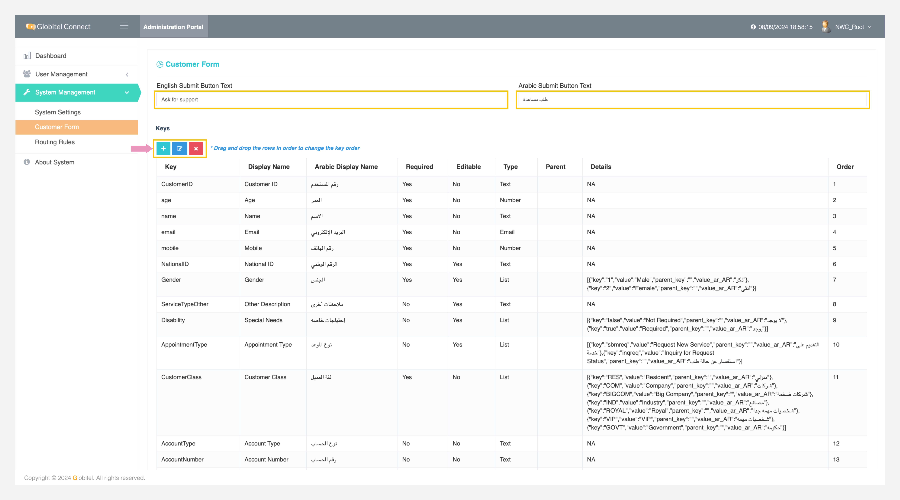
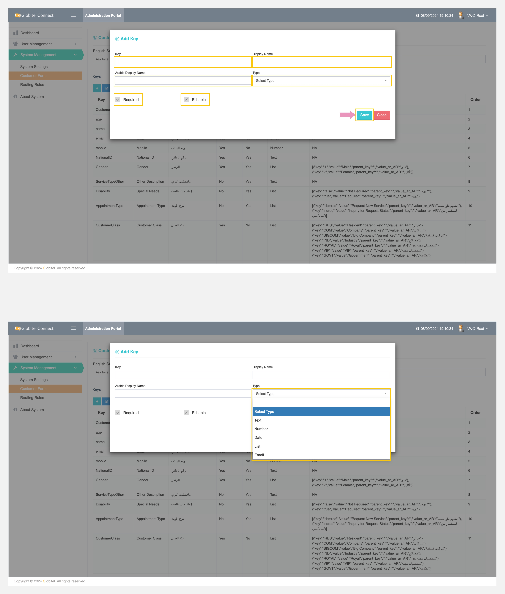

---
tags:
  - Manage Customer Attributes
  - Update Customer Form
  - Add New Attribute
  - Edit Selected Attribute
  - Delete Selected Attribute
---
# Customer Form Attributes (Custom Attributes)

---
Under Customer Form Attributes, you can customize the customer form for call requests by adding custom attributes. This allows customers to fill in these fields when requesting a call or appointment. It helps you tailor the data requested from customers and use it within the system by creating [routing rules](Routing-Rules.md) for these fields.

How can I access Custom Attributes?

You can access Custom Attributes by selecting "System Management" > "Customer Form" from the left-side menu.

How can I sort attributes?

You can sort the list of attributes by dragging and dropping the rows to change their order in the table.

## Add Custom Attribute (Add Key)

You can add a new key (attribute) by clicking on the ":octicons-diff-added-16:" icon and filling in the following fields:

- Key: Used to add a key value in the system.
- Display Name: Used to add the English-friendly display name.
- Arabic Display Name: Used to add the Arabic-friendly display name.
- Type: Used to select the type of field, including Text, Number, Date, List, or Email.
- Required: Used to select whether this field must be filled out by the customer or not.
- Editable: Used to enable or disable the agent's ability to edit the customer information value for this key (attribute).

Finally, click on "Save" to add the key to the customer form.

Related Articles:

- [Dashboard](../My-Dashboard.md)
- [Users Management](../User-Management/Users-Management.md)

