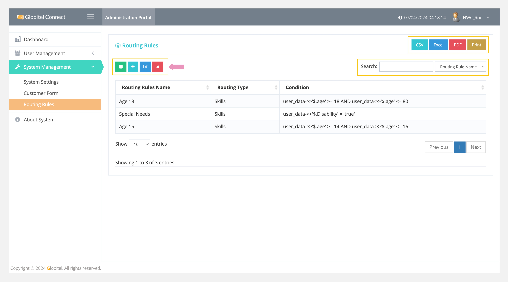
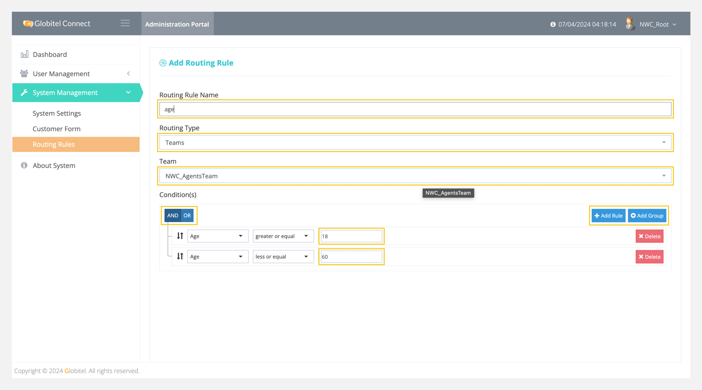

---
tags:
  - Manage Rules
  - Rules
  - Create New Rule
  - Edit Selected Rule
  - Delete Selected Rule
  - Manage Routing Rules
---
# Rules Management (Routing Rules)

---
Under Routing Rules, you can add custom rules for your team(s) and use these rules within the system. This allows you to define rules for each team and add conditions using `AND` and `OR` logic for Skills or Teams types.

How can I access Routing Rules?

You can access Custom Attributes by selecting "System Management" > "Routing Rules" from the left-side menu.

!!! tip "Tip"
    You can export all routing rules in CSV, Excel, or PDF format.

!!! info "Info"
    You can search for any rule by typing the routing rule name in the search box to view the matched results. Use the drop-down to select the search criteria: "routing rule name," "type," or "condition."

## Add Rule

You can add a new rule by clicking on the ":octicons-diff-added-16:" icon and filling in the following fields:

- Routing Rule Name: Used to add the English-friendly name for the rule.
- Routing Type: Used to select the type of this rule. There are two types: Skills and Teams.

Then you need to add the condition(s). There are two types of conditions:

- AND condition: All specified conditions must be met for the rule to apply.
- OR condition: At least one of the specified conditions must be met for the rule to apply.

!!! tip "Tip"
    You can add more rules or groups of rules using `AND` / `OR` conditions.

Finally, click on "Save" to add the rule to the system.

Related Articles:

- [Skills Management](../User-Management/Skills-Management.md)
- [Teams Management](../User-Management/Teams-Management.md)
- [Users Management](../User-Management/Users-Management.md)
