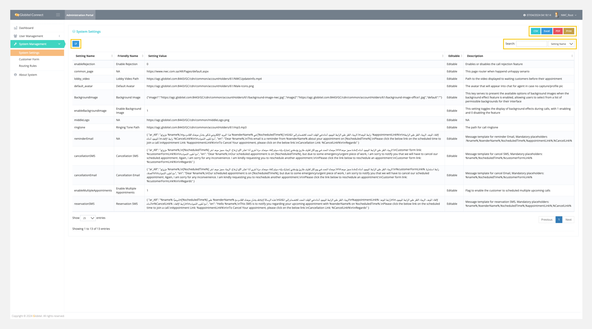

---
tags:
  - Manage Settings
  - Update System Settings
  - Update Selected Row
---
# System Settings

---
Under System Settings, you can edit system localizations and settings by changing the editable fields. This is helpful to customize your system identity and cretira.

How can I access System Settings?

You can access System Settings by selecting "System Management" > "System Settings" from the left-side menu.

!!! tip "Tip"
    You can export all system settings in CSV, Excel, or PDF format.

!!! info "Info"
    You can search for any setting by typing the setting name in the search box to view the matched results.

## What Types of System Settings Can I Edit?

You can edit any system setting by selecting the corresponding row and then clicking on the edit ":material-square-edit-outline:" icon to start editing that key.

| **Setting Name**           | **Description** |
| -------------------------- | --------------- |
| enableRejection            | Enables or disables the call rejection feature, with 1 enabling and 0 disabling the feature. |
| common_page                | This page router when an unhappy scenario happens. This is a hyperlink value of the page. |
| lobby_video                | Path to the video displayed to waiting customers before their appointment. This used to upload video (Supported video type ( MP4 )). |
| default_avatar             | The avatar that will appear in chat for the agent if no capture/profile picture is available. This used to upload images (Supported background image type ( gif, jpg, png, jpeg, svg )). |
| BackgroundImage            | This key serves to present the available options of background images when the background effect feature is enabled. This used to upload images (Supported background image type ( gif, jpg, png, jpeg, svg )). |
| enableBackgroundImage      | This setting toggles the display of background effects during calls, with 1 enabling and 0 disabling the feature. |
| middleLogo | The company logo displayed on the portal. This used to upload images (Supported background image type ( gif, jpg, png, jpeg, svg )). |
| ringtone                   | The path for call ringtone. This used to upload ringtone sound (Supported sound type ( .MP3 )). |
| reminderEmail              | Message template (Arabic and English) for reminder Email, Mandatory placeholders: %name%, %senderName%, %scheduledTime%, %appointmentLink%, %CancelLink%. For example: `{ "ar_AR": "عزيزي %name%,\nهذا البريد الإلكتروني تذكير بشأن موعدك القادم مع %senderName% في [%scheduledTime%].\nالرجاء النقر على الرابط الموجود أدناه في الوقت المحدد للانضمام إلى المكالمة.\nرابط الموعد: %appointmentLink%\n\nلإلغاء الموعد، الرجاء النقر على الرابط الموجود أدناه.\nرابط الإلغاء: %CancelLink%\n\nمع أطيب التحيات", "en": "Dear %name%,\nThis email is a reminder from %senderName% about your appointment on [%scheduledTime%].\nPlease click the below link on the scheduled time to join a call.\nAppointment Link: %appointmentLink%\n\nTo Cancel Your appointment, please click on the below link.\nCancellation Link: %CancelLink%\n\nRegards" }`  |
| cancellationSMS            | Message template (Arabic and English) for cancellation SMS, Mandatory placeholders: %name%, %scheduledTime%, %customerFormLink%. For example: `{ "ar_AR": "عزيزي %name%,\n[%scheduledTime%] موعدك المحدد في يوم لكن لظرف طارئ يؤسفني إخبارك بإنه سيتم إلغاء موعدك. مرة أخرى أنا اعتذر لأي إزعاج. الرجاء حجز موعد آخر.\n\nالرجاء النقر على الرابط الموجود أدناه لإعادة حجز موعد:\nCustomer form link: %customerFormLink%\n\nمع أطيب التحيات", "en": "Dear %name%,\nOur scheduled appointment is on [%scheduledTime%], but due to some emergency/urgent piece of work, I am sorry to notify you that we will have to cancel our scheduled appointment. Again, I am sorry for any inconvenience. I am kindly requesting you to reschedule another appointment.\n\nPlease click the link below to reschedule an appointment:\nCustomer form link: %customerFormLink%\n\nRegards" }` |
| cancellationEmail          | Message template (Arabic and English) for cancellation Email, Mandatory placeholders: %name%, %scheduledTime%, %customerFormLink%. For example: `{ "ar_AR": "عزيزي %name%,\n[%scheduledTime%] موعدك المحدد في يوم لكن لظرف طارئ يؤسفني إخبارك بإنه سيتم إلغاء موعدك. مرة أخرى أنا اعتذر لأي إزعاج. الرجاء حجز موعد آخر.\n\nالرجاء النقر على الرابط الموجود أدناه لإعادة حجز موعد:\n%customerFormLink% :رابط استمارة العملاء\n\nمع أطيب التحيات", "en": "Dear %name%,\nOur scheduled appointment is on [%scheduledTime%], but due to some emergency/urgent piece of work, I am sorry to notify you that we will have to cancel our scheduled appointment. Again, I am sorry for any inconvenience. I am kindly requesting you to reschedule another appointment.\n\nPlease click the link below to reschedule an appointment:\nCustomer form link: %customerFormLink%\n\nRegards" }` |
| enableMultipleAppointments | Flag to enable the customer to schedule multiple upcoming calls, with 1 enabling and 0 disabling the feature. |
| reservationSMS             | Message template (Arabic and English) for reservation SMS, Mandatory placeholders: %name%, %senderName%, %scheduledTime%, %appointmentLink%, %CancelLink%. For example: `{ "ar_AR": "%name% مرحبًا\n[%scheduledTime%] على %senderName% هذه الرسالة لإبلاغك بشأن موعدك القادم مع.\nالرجاء النقر على الرابط الموجود أدناه في الوقت المحدد للانضمام إلى المكالمة\n%appointmentLink% :رابط الموعد\n\n.لإلغاء الموعد، الرجاء النقر على الرابط الموجود أدناه\n%CancelLink% :رابط الإلغاء\n\nمع أطيب التحيات", "en": "Hello %name%,\nThis SMS is to notify you regarding your upcoming appointment with %senderName% on %scheduledTime%.\nPlease click the below link on the scheduled time to join a call.\nAppointment Link: %appointmentLink%\n\nTo Cancel Your appointment, please click on the below link.\nCancellation Link: %CancelLink%\n\nRegards" }` |

Related Articles:

- [Dashboard](../My-Dashboard.md)
- [Skills Management](../User-Management/Skills-Management.md)
- [Teams Management](../User-Management/Teams-Management.md)
- [Routing Rules](../System-Management/Routing-Rules.md)