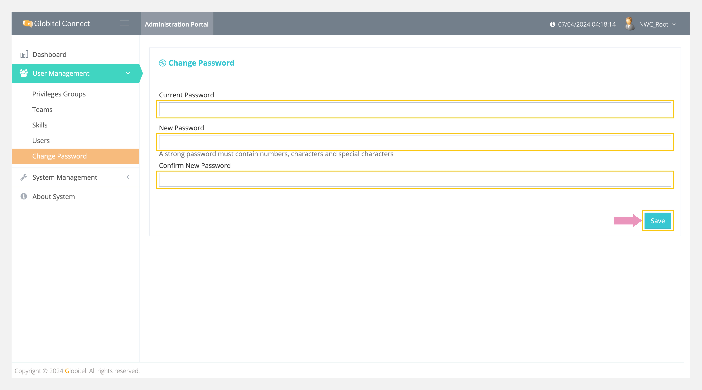

---
tags:
  - Update My Admin Password
  - Create New Password
  - Admin Password Security
hide:
  - toc
---
# Change My Password

---
You can change your current password to secure your account or if you're logging into the system for the first time and need to change the provided password.

How can I change my current password?

To change your password, follow these steps:

1. Click on the User Management drop-down in the left side panel.
2. Select "Change Password" from the drop-down.
3. A new page will appear for changing your password.
4. Enter your current password in the "Current Password" field.
5. Finally, enter and confirm your new password and click "Save".

!!! tip "Tip"
    Ensure you create a strong password with at least eight characters. It should include at least one number, one special character, one uppercase letter, and one lowercase letter.

Related Articles:

- [Dashboard](../My-Dashboard.md)
- [Routing Rules](../System-Management/Routing-Rules.md)
- [Customer Form](../System-Management/Customer-Form.md)