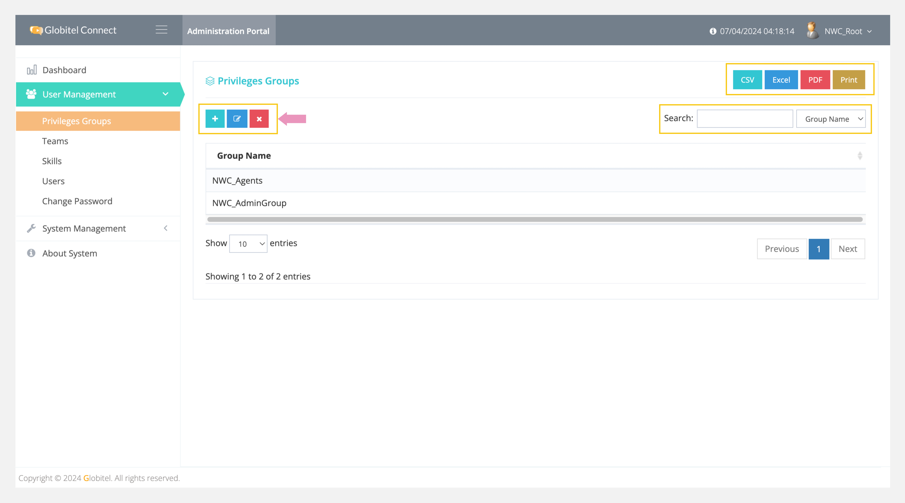
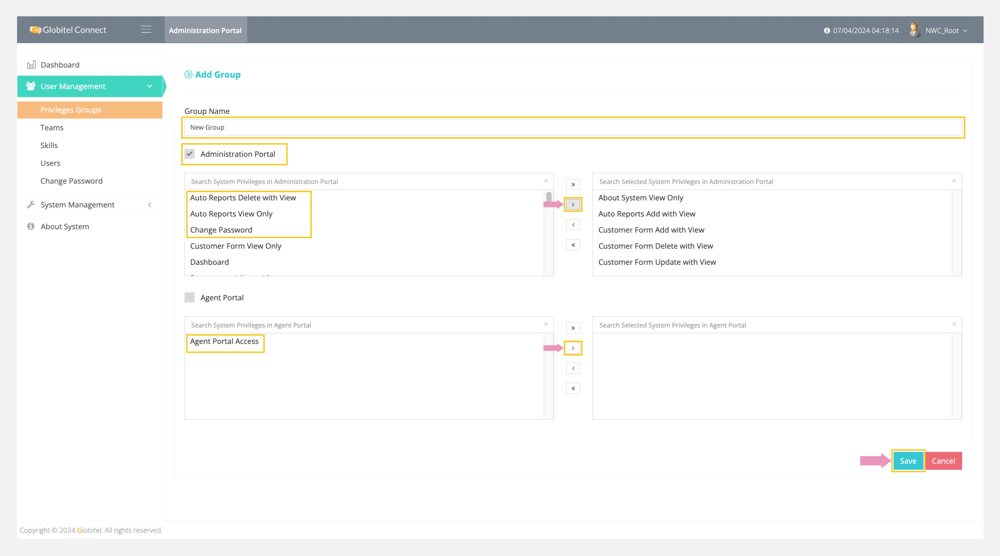

---
tags:
  - Manage Roles
  - Create Role
  - Administration Roles
  - Agent Roles
  - Edit Selected Role
  - Delete Selected Role
---

# Roles Management

---
Under roles management (Privileges Groups), you can create a new group of roles, update selected groups, and delete selected groups. You can select this group of roles when [adding a new user](Users-Management.md) to determine their access to the agent or admin portal according to these roles.

!!! tip "Tip"
    You can export all privileges groups in CSV, Excel, or PDF format.

How can I access roles management (privileges groups)?

To access roles management section, follow these steps:

1. Click on the User Management drop-down in the left side panel.
2. Select "Privileges Groups" from the drop-down.
3. A new page will appear displaying a list of all groups.

!!! tip "Tip"
    You can search for any group by typing the group name in the search box to view the matched results.

## Add Role

You can add a new group by clicking on the ":octicons-diff-added-16:" icon on the main page of the privileges groups management and filling in the following fields:

- Group Name: Use this field to add a friendly name for this group, such as "Admin Group" or "Agent Group".

Then, you need to select which portal to link with this group. There are two portals:

1. Administration Portal: Select roles for accessing the administration portal, such as managers.
2. Agent Portal: Select roles for accessing the agent portal, such as agents or supervisors.

### Administration Portal Roles

| Role                              | Description                                         |
| --------------------------------- | --------------------------------------------------- |
| About System View Only            | Allows viewing of system information.               |
| Auto Reports Add with View        | Allows adding and viewing auto-generated reports.   |
| Auto Reports Delete with View     | Allows deleting and viewing auto-generated reports. |
| Auto Reports View Only            | Allows viewing of auto-generated reports.           |
| Change Password                   | Allows the user to change their password.           |
| Customer Form Add with View       | Allows adding and viewing customer forms.           |
| Customer Form Delete with View    | Allows deleting and viewing customer forms.         |
| Customer Form Update with View    | Allows updating and viewing customer forms.         |
| Customer Form View Only           | Allows viewing customer forms.                      |
| Dashboard                         | Allows access to the dashboard stats.               |
| Privilege Groups Add with View    | Allows adding and viewing privilege groups.         |
| Privilege Groups Delete with View | Allows deleting and viewing privilege groups.       |
| Privilege Groups Update with View | Allows updating and viewing privilege groups.       |
| Privilege Groups View Only        | Allows viewing privilege groups.                    |
| Routing Rule Add with View        | Allows adding and viewing routing rules.            |
| Routing Rule Delete with View     | Allows deleting and viewing routing rules.          |
| Routing Rule Update with View     | Allows updating and viewing routing rules.          |
| Routing Rule View Only            | Allows viewing routing rules.                       |
| Skill Add with View               | Allows adding and viewing skills.                   |
| Skill Delete with View            | Allows deleting and viewing skills.                 |
| Skill Update with View            | Allows updating and viewing skills.                 |
| Skill View Only                   | Allows viewing skills.                              |
| System Settings Update with View  | Allows updating and viewing system settings.        |
| System Settings View Only         | Allows viewing system settings.                     |
| Team Add with View                | Allows adding and viewing teams.                    |
| Team Delete with View             | Allows deleting and viewing teams.                  |
| Team Update with View             | Allows updating and viewing teams.                  |
| Team View Only                    | Allows viewing teams.                               |
| Users Add with View               | Allows adding and viewing users.                    |
| Users Delete with View            | Allows deleting and viewing users.                  |
| Users Update with View            | Allows updating and viewing users.                  |
| Users View Only                   | Allows viewing users.                               |

Finally, click on "Save" to add the role to the system.

Related Articles:

- [Users Management](./Users-Management.md)
- [Skills Management](./Skills-Management.md)
- [System Settings](../System-Management/System-Settings.md)
- [About the System](../About-System.md)