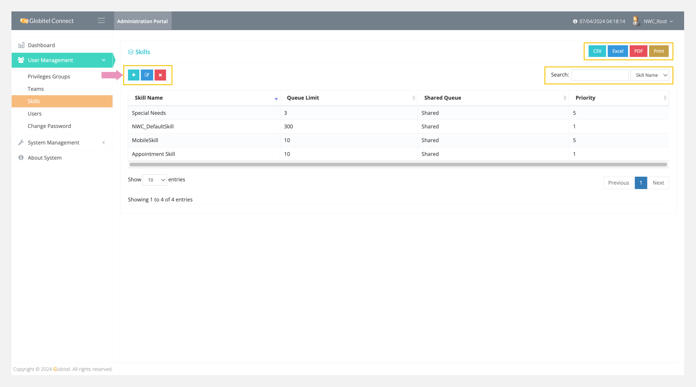
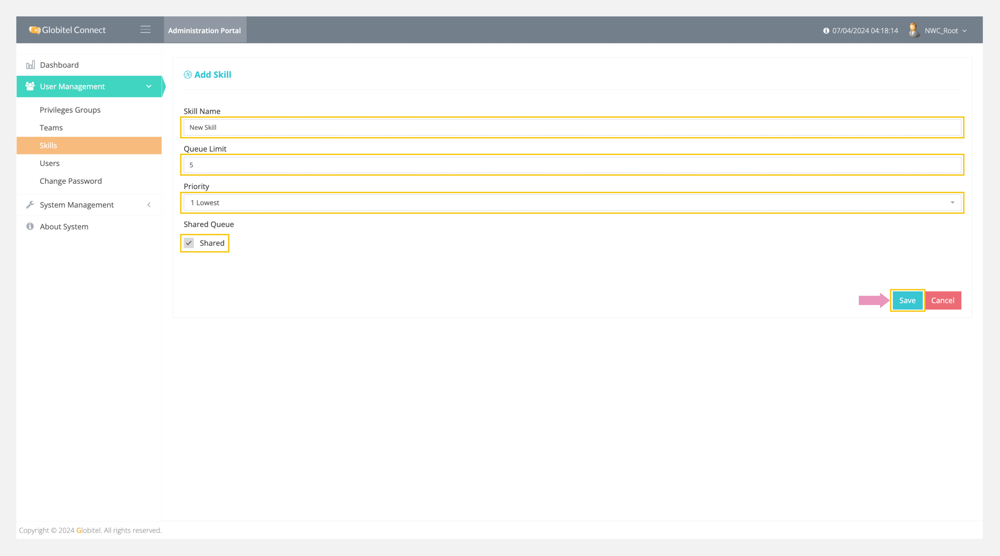

---
tags:
  - Manage Skills
  - Skills
  - Create New Skill
  - Edit Selected Skill
  - Delete Selected Skill
---
# Skills Management

---
Skills management allows you to manage all skills in the system by adding new skills, updating selected skills, and deleting selected skills. It helps you add skill levels, such as language skills, communication skills, and management skills, to the system. These skills can be assigned to agents when [adding users](Users-Management.md) or [creating routing rules](../System-Management/Routing-Rules.md).

!!! tip "Tip"
    You can export all skills in CSV, Excel, or PDF format.

How can I access skills management?

To access skills management section, follow these steps:

1. Click on the User Management drop-down in the left side panel.
2. Select "Skills" from the drop-down.
3. A new page will appear displaying a list of all skills.

!!! tip "Tip"
    You can search for any skill by typing the skill name in the search box to view the matched results.

## Add Skill

You can add a new skill by clicking on the ":octicons-diff-added-16:" icon on the main page of the skills management and filling in the following fields:

- Skill Name: Enter the name or title of the skill.
- Queue Limit: Set the maximum queue length for this skill.
- Priority: Assign a priority level for this skill, ranging from 1 (Lowest) to 5 (Highest).
- Shared Queue: Enabling this option allows interactions to be shared with other agents, enabling sharing of the queue among agents.

Finally, click on "Save" to add the skill to the system.

!!! tip "Tip"
    You can update or delete the selected skill by clicking on the respective update or delete icon.

Related Articles:

- [Routing Rules](../System-Management/Routing-Rules.md)
- [Roles Management](./Roles-Management.md)
- [System Settings](../System-Management/System-Settings.md)
- [About the System](../About-System.md)
- [Dashboard](../My-Dashboard.md)
