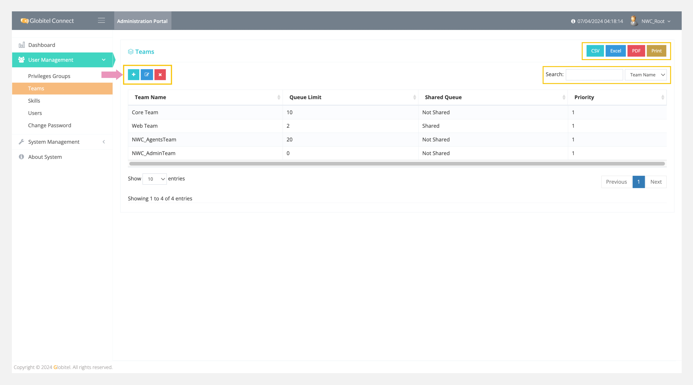
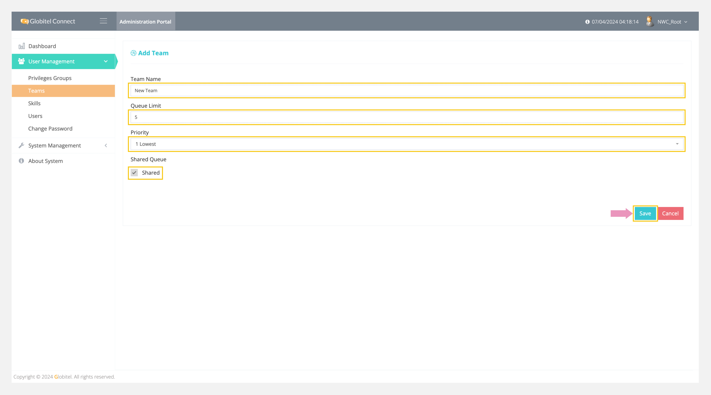

---
tags:
  - Manage Teams
  - Teams
  - Create New Team
  - Edit Selected Team
  - Delete Selected Team
---
# Teams Management

---
Teams management allows you to manage all teams in the system by adding new teams, updating selected teams, and deleting selected teams. It helps you add team levels, such as managers, supervisors, and agent teams, to the system. These teams can be linked to agents when [adding users](Users-Management.md) or [creating routing rules](../System-Management/Routing-Rules.md).

!!! tip "Tip"
    You can export all teams in CSV, Excel, or PDF format.

How can I access teams management?

To access teams management section, follow these steps:

1. Click on the User Management drop-down in the left side panel.
2. Select "Teams" from the drop-down.
3. A new page will appear displaying a list of all teams.

!!! tip "Tip"
    You can search for any team by typing the team name in the search box to view the matched results.

## Add Team

You can add a new team by clicking on the ":octicons-diff-added-16:" icon on the main page of the teams management and filling in the following fields:

- Team Name: Enter the name or title of the team.
- Queue Limit: Set the maximum queue length for this team.
- Priority: Assign a priority level for this team, ranging from 1 (Lowest) to 5 (Highest).
- Shared Queue: Enabling this option allows interactions to be shared with other agents, enabling sharing of the queue among agents.

Finally, click on "Save" to add the team to the system.

!!! warning "Caution"
    No calls will be accepted when the number of waiting customers in the queue reaches the maximum limit.

!!! tip "Tip"
    You can update or delete the selected team by clicking on the respective update or delete icon.

Related Articles:

- [Routing Rules](../System-Management/Routing-Rules.md)
- [Users Management](./Users-Management.md)
- [System Settings](../System-Management/System-Settings.md)
- [Dashboard](../My-Dashboard.md)
