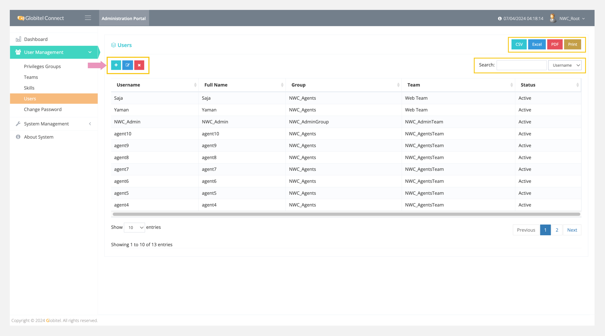
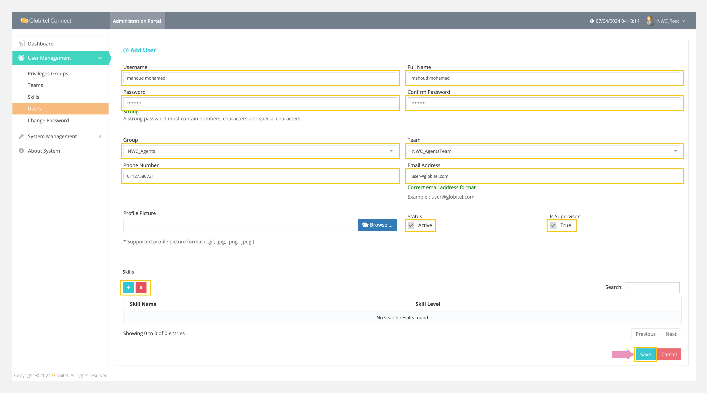

---
tags:
  - Manage Users
  - Users
  - Create New User
  - Edit Selected User
  - Delete Selected User
---

# Users Management

---
Teams management allows you to manage all users in the system by adding new users, updating selected users, and deleting selected users. It is essential to add agents, supervisors, and admins to enable them to start accessing the agent and admin portals.

!!! tip "Tip"
    You can export all users in CSV, Excel, or PDF format.

How can I access users management?

To access users management section, follow these steps:

1. Click on the User Management drop-down in the left side panel.
2. Select "Users" from the drop-down.
3. A new page will appear displaying a list of all users.

!!! tip "Tip"
    You can search for any user by typing the username in the search box to view the matched results.

## Add User

You can add a new user by clicking on the ":octicons-diff-added-16:" icon on the main page of the teams management and filling in the following fields:

- Username: Enter the username the user will use to log in.
- Full Name: Type the full name of the user.
- Password: Add the initial login password for this user.
- Confirm Password: Re-type the password to confirm it.
- Group: Select the [privilege group](Roles-Management.md) for this user.
- Team: Select the [related team](Teams-Management.md) for this user.
- Phone Number: Add the phone number of this user.
- Email: Add the email address of this user.
- Status: Set the user as active to allow portal access.
- Is Supervisor?: Grant the user supervisor permissions.

You can select [skills](Skills-Management.md) for this user by clicking on the "+" icon under the skills section while adding a new user.

Finally, click on "Save" to add the team to the system.

!!! tip "Tip"
    You can update or delete the selected user by clicking on the respective update or delete icon.

Related Articles:

- [Dashboard](../My-Dashboard.md)
- [Roles Management](./Roles-Management.md)
- [Teams Management](./Teams-Management.md)
- [System Settings](../System-Management/System-Settings.md)