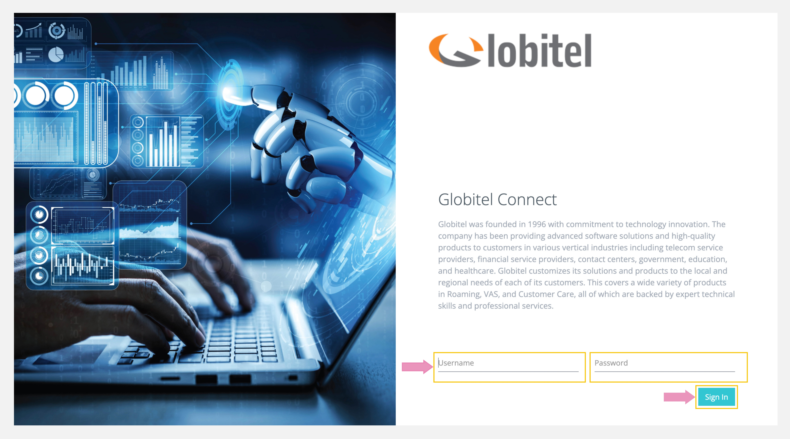

---
tags:
  - Log In
  - Getting Started
  - Login
  - Access Admin Portal
hide:
  - toc
---

# Login

---
Logging in is the initial step to access Globitel Connect Administration Portal.

How to access the Log In page?

To access the Globitel Connect Admin Portal, follow these sample instructions:

1. Open your preferred web browser. This could be Google Chrome, Firefox, Microsoft Edge, or Opera.
2. In the address bar, enter the server URL in the following format: `http://Server_Name:Port/gc-mobile`. Please ensure you replace `Server_Name` and `Port` with the specific details provided to you from your development team.

How to log in?

To Log in to your account on Globitel Connect Admin Portal, follow these steps:

1. Type your User Name in the `'Username'` field.
2. Next, input your Password in the `'Password'` field.
3. Click on the `'Login'` button or press Enter to proceed.

!!! tip "Tip"
    Please make sure to use the correct credentials provided to you for a successful login. Also, you can change your password to protect your account after the first login. [You can find the details here](../Administration/User-Management/Change-Password.md).

Related Articles:

- [Change Password](./User-Management/Change-Password.md)
- [System Settings](./System-Management/System-Settings.md)
- [About the System](./About-System.md)
