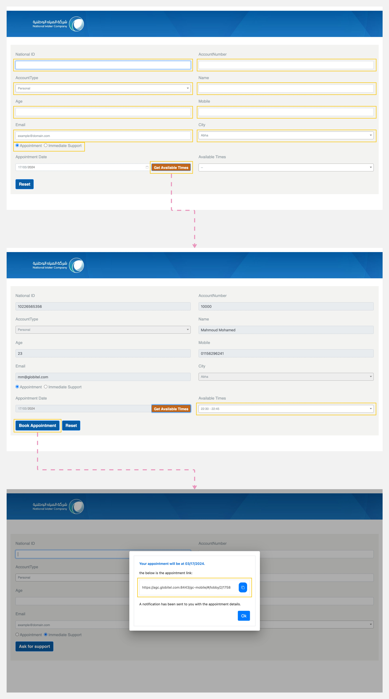

---
tags:
  - Request Call
  - Set a Call
  - Scheduling an Appointment
hide:
  - toc
---

# Requesting a Meeting

---
As a customer, you have the ability to request a new appointment or immediate support, which will initiate interaction with an agent.

How to request a new meeting?

1. Navigate to the URL provided by customer support or find it on the customer support page.
2. Input the necessary personal information: National ID, Account Number, Account Type, Name, Age, Mobile, Email, and City.
3. Choose the type of meeting you want. There are two options: 'Appointment', which enables you to select a custom date and time, or 'Immediate Support', which is for requesting a meeting now.
4. Click 'Book Appointment' to begin the meeting request process.
5. A pop-up will appear containing the link to your meeting.
6. If you selected immediate support, you can copy and paste the link into a new browser tab to [start a meeting](Starting-a-Meeting.md) with an agent.

!!! tip "Tip"
    If you requested a meeting, an email containing the meeting link and your details will be sent to you.

