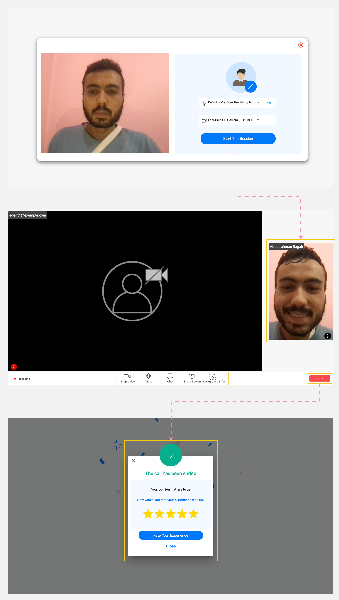

---
tags:
  - Interact with Agent
  - Room Control
  - Manage Call
---

# Starting a Meeting

---
After [requesting a meeting](Requesting-a-Meeting.md), click on "Ready for Engagements" to begin interacting with an agent.

!!! warning "Caution"
    Make sure your default microphone is unmuted and your camera is turned on before you start interacting with the agent.

The meeting room will be displayed, and it features two sections:

1. Meeting Panel: This section shows the live feed and microphone status of both the agent and yourself.
2. Meeting Functions: This section contains various actions you can perform during the meeting.

## Meeting Functions

Here are seven functions you can use during your interaction with the agent in the meeting room:

1. Turn your camera ON/OFF.
2. Mute/Unmute your microphone.
3. [Share your screen](../Handling-Interactions/Screen-sharing.md) with the agent.
4. [Change the background](../Handling-Interactions/Change-background-and-blur.md) while your camera is on.
5. [Chat](../Handling-Interactions/Chat.md) with the agent.
6. [Exchange documents](../Handling-Interactions/Exchanging-documents.md) with the agent.
7. Hang Up to end the meeting and rate your experience.

!!! tip "Tip"
    After ending the call, you can rate your experience with the agent on a scale from 1 to 5, with 5 being the highest and 1 the lowest.

