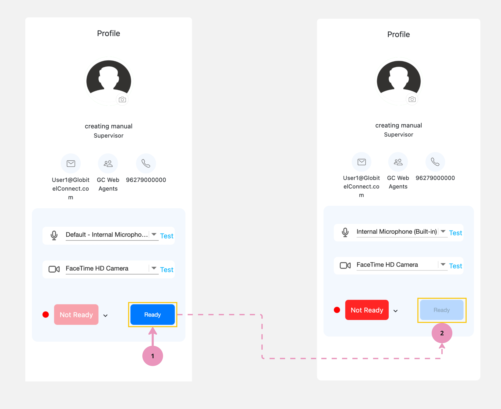

---
tags:
  - Start Engagments
  - Getting Ready
  - Ready for Calls
  - Ready
hide:
  - toc
---

# Getting Ready For Engagements

---
Now you have logged in; you can start handling interactions with customers. Here you need to tell the customers that you are ready. Otherwise, you will not receive any interaction as the system will assume that you are busy.

!!! warning "Caution"
    If you are a supervisor handling only interactions transferred from your team members, you need to be ready. Otherwise, the system will assume that you are busy and you will not receive any transferred interactions.

How to get ready for engagements?

To be ready for interactions, press the "Ready" button located under your profile panel in the dashboard.

Related Articles:

- [Dashboard](../Getting-started/My-dashboard.md)
- [Testing Your Microphone & Camera](../Getting-started/Testing-your-camera-and-microphone.md)
