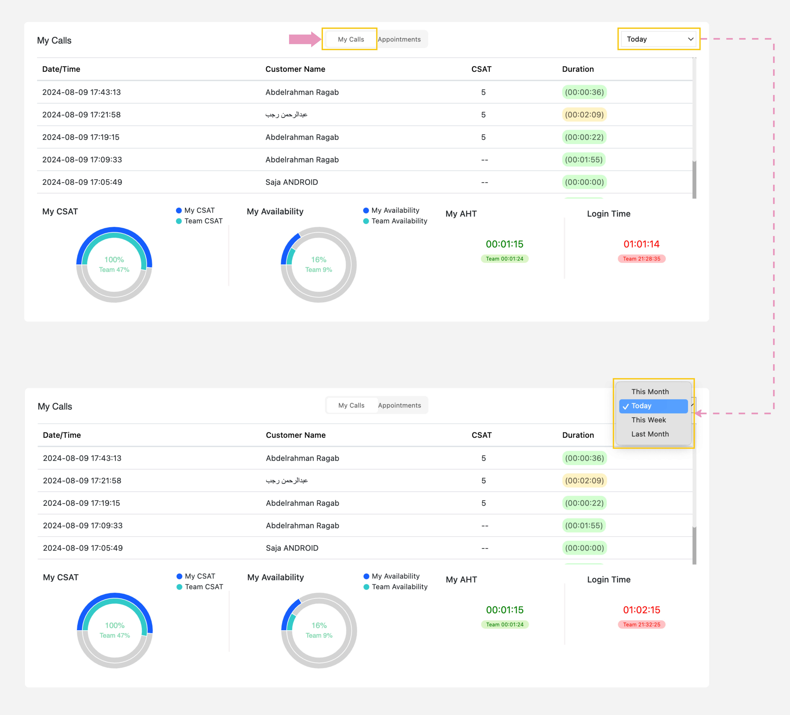

---
tags:
  - My Calls
  - Calls History
  - My Interactions
  - My History
hide:
  - toc
---
# Interaction History

---
The interaction history feature provides a comprehensive overview of your past calls with customers.

How can I access the interaction history?

On the "Dashboard" page, you can view the details of your calls in the "My Calls" grid. The following information is available:

| Name | Description |
| :------------ | :--------- |
| Date & Time | This shows the start date and time of each interaction. |
| Customer Name | This shows the full name of the customer. |
| CSAT (Customer Satisfaction Score) | This displays the customer's rating based on the rating survey results after the interaction and is a rating from 1 (lowest rating) to 5 (highest rating). |
| Duration | This refers to the duration of each interaction. The colors indicate the start and end periods. For instance, green indicates 0 to 2 minutes, yellow indicates 2 to 4 minutes, and red represents 4 to 6 minutes. |

!!! tip "Tip"
    You can filter your previous interactions by "This Month", "Today", "This Week", or "Last Month".

Also, you can view the call statistics and charts as follows:

- My CSAT (%): Displays the Customer Satisfaction Score (CSAT) percentage out of 100, based on survey results for you and your team.
- My Availability (%): Shows data on agent availability for you and your team. It calculates the ratio between overall ready time and duty time for selected durations (today, this week, this month, and last month). Ready time includes on-call and available time, while duty time encompasses on-call, available, online, do not disturb, and break times.
- My AHT (HH:MM:SS): Displays the average handling time (AHT) for all records, measured in hours, minutes, and seconds, for you and your team.
- Login Time (HH:MM:SS): Displays the total time logged in from the login moment to the current time for you and your team, measured in hours, minutes, and seconds.

Related Articles:

- [Dashboard](../Getting-started/My-dashboard.md)
- [Getting ready for engagements](../Getting-started/Getting-ready-for-engagements.md)
