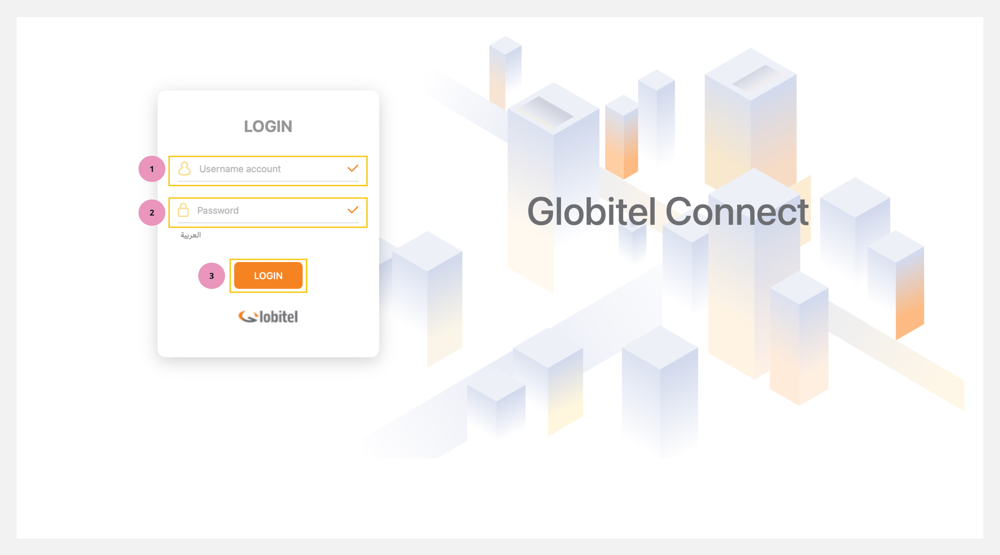

---
tags:
  - Log In
  - Getting Started
  - Login
  - Access Globitel Connect
hide:
  - toc
---

# Login

---
Logging in is the initial step to access Globitel Connect. Your permissions, such as Agent or Supervisor, will determine the system features and functionalities available to you.

How to access the Log In page?

To access the Globitel Connect web application, follow these sample instructions:

1. Open your preferred web browser. This could be Google Chrome, Firefox, Microsoft Edge, or Opera.
2. In the address bar, enter the server URL in the following format: `http://Server_Name:Port/gc-mobile`. Please ensure you replace `Server_Name` and `Port` with the specific details provided to you from your administrator.

!!! tip "Tip"
    The preferred web browser for Globitel Connect is Google Chrome. You can download it from [this link](https://www.google.com/chrome/). It supports all operating systems, including Windows, Mac, and Linux.

How to log in?

To Log in to your account on Globitel Connect, follow these steps:

1. Type your User Name in the `'Username Account'` field.
2. Next, input your Password in the `'Password'` field.
3. Click on the `'Login'` button or press Enter to proceed.

!!! tip "Tip"
    Please make sure to use the correct credentials provided to you for a successful login. Also, you can change your password to protect your account after the first login. [You can find the details here](../My-profile/Change-password.md).

Related Articles:

- [Dashboard](../Getting-started/My-dashboard.md)
- [Testing your Camera and Microphone](../Getting-started/Testing-your-camera-and-microphone.md)
- [Getting ready for engagements](../Getting-started/Getting-ready-for-engagements.md)
- [Change My Password](../My-profile/Change-password.md)
