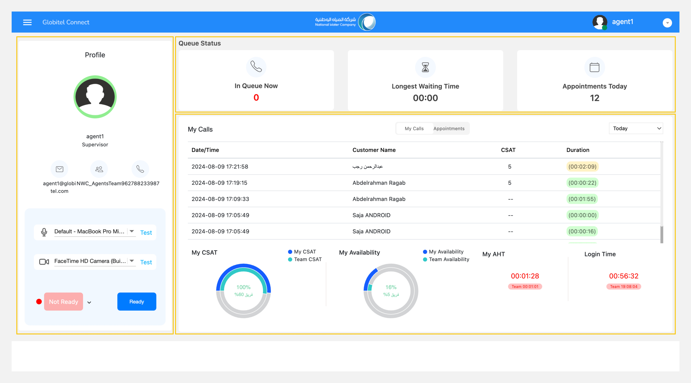
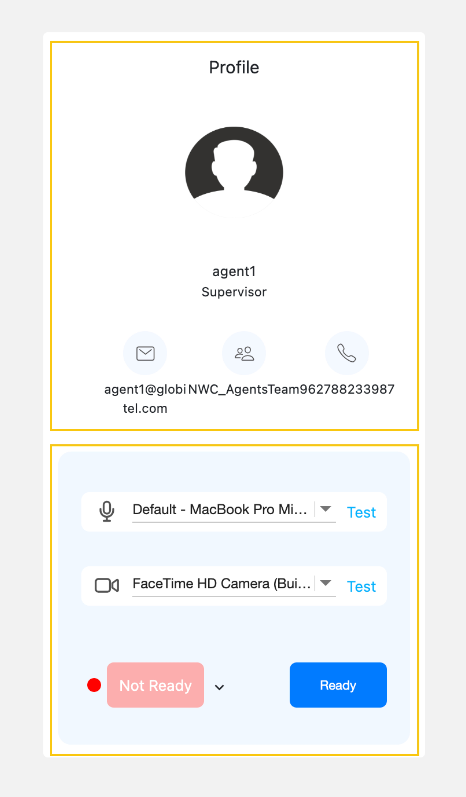

---
tags:
  - My Dashboard
  - Home
  - Landing Page
  - Dashboard
---

# My Dashboard

---
This is the first screen you will access after [logging in](Login.md) and [sharing your screen](Share-screen.md). It's a landing page that provides comprehensive details about customers interactions, your own performance, and being ready to receive new customer interactions. This is extremely useful for giving you a view of what's happening around you.

This screen consists of the following parts:

1. Stats cards (queue and appointments).
2. Profile and status panel.
3. Interaction history and appointments grid.

## Stats Cards (Queue Status)

These are cards at the top of the dashboard screen that give you an idea of what is happening with the customers at the current moment. There are three cards to show you the following:

- In Queue Now (#): This is the number of customers that are currently waiting in the lobby to be answered.
- Longest Waiting Time (MM:SS): This displays the time of the customer who has been waiting the longest.
- Appointments Today (#): This is the total number of all customer appointments for the current day.

## Profile and Status Panel

The profile panel displays your profile information, which includes:

- Profile Picture: Your image displayed during customer calls.
- Full Name: Your full name displayed during customer calls.
- Email: Your registered email in the system.
- Team: The team you belong to.
- Phone Number: Your work phone number.

The status panel allows you to update your current availability status, preparing you to start [getting ready for engagements](Getting-ready-for-engagements.md) with customers.

## Interaction History and Appointments Grid

This grid shows you the history of your interactions with customers and all upcoming appointments.

!!! tip "Tip"
    If you have supervisor permissions, you will be able to see all interactions history and appointments for your team.

[Interaction history](Interaction-history.md) tab covers the following information:

| Name | Description |
| :------------ | :--------- |
| Date & Time | This shows the start date and time of each interaction. |
| Customer Name | This shows the full name of the customer. |
| CSAT (Customer Satisfaction Score) | This displays the customer's rating of the call, which is a rating between 1 (lowest rating) to 5 (highest rating) based on the survey result and in case of no rating it shows "--". |
| Duration | This refers to the duration of each interaction. The colors indicate the start and end periods. For instance, green indicates 0 to 2 minutes, yellow indicates 2 to 4 minutes, and red represents 4 to 6 minutes. |

[Appointments](Appointments.md) tab covers the following information:

| Name | Description |
| :------------ | :--------- |
| Appointment Time | Shows the appointment slot in date and time format. |
| Call Completion Status | This displays the current status of the appointment if it is upcoming, rescheduled, completed, or cancelled. |

Related Articles:

- [Getting ready for engagements](../Getting-started/Getting-ready-for-engagements.md)
- [Interaction history](../Getting-started/Interaction-history.md)
- [Appointments](../Getting-started/Appointments.md)
