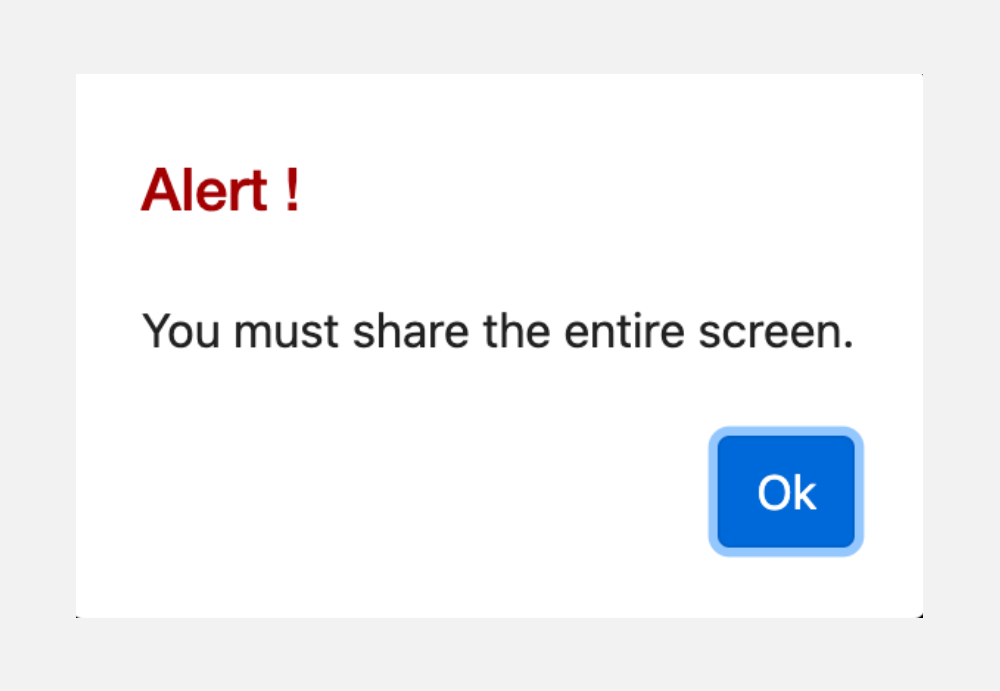
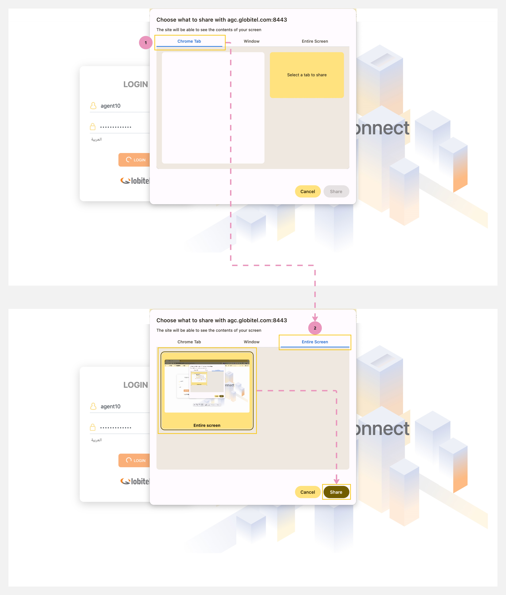

---
tags:
  - Getting Started
  - Sharing Screen
  - Required Action
hide:
  - toc
---

# Share Screen (Required)

---

This is a crucial step for you to start using the system. You will need to share your browser entire screen with the system so that it records your screen activities for the purpose of Quality Monitoring.

!!! warning "Caution"
    The system will not allow you to proceed or handle interactions if you do not perform this step.

{ width=250 }

How to share your browser entire screen?

After you [log in](Login.md), the system will automatically show a pop-up window, where you need to follow these
steps:

1. Click on the "Entire Screen" tab in the pop-up window.
2. Proceed to select your entire browser screen.
3. Finally, click on the "Share" button to commence the screen sharing.

!!! tip "Tip"
    The system will record all your screen activities during the call and will stop recording once the call ends.

Related Articles:

- [Testing your Camera and Microphone](../Getting-started/Testing-your-camera-and-microphone.md)
- [Getting ready for engagements](../Getting-started/Getting-ready-for-engagements.md)
