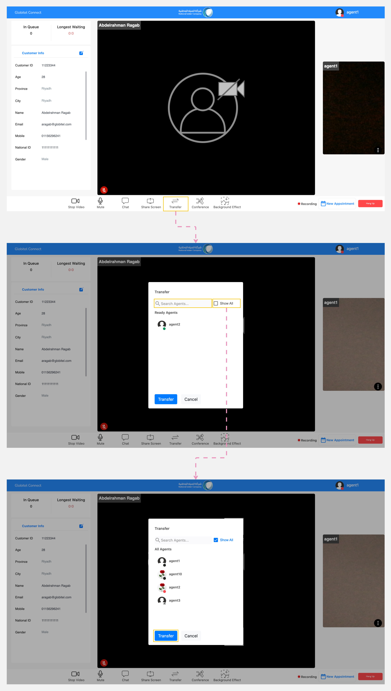

---
tags:
  - Transfering Call
  - Transfer to another Agent
hide:
  - toc
---

# Call Transfer

---
This function enables you to transfer your active interaction with customer to another ready and available agent for handling.

How can I transfer the call to another agent?

To transfer the call, follow these steps:

1. Click on the "Transfer" button located in the meeting functions section.
2. A pop-up window will appear, showing available agents by default.
3. You can search for a specific agent by typing their name in the search box.
4. Finally, select the agent and click on the "Transfer" button.

Related Articles:

- [Chat](../Handling-Interactions/Chat.md)
- [Exchanging Documents](../Handling-Interactions/Exchanging-documents.md)