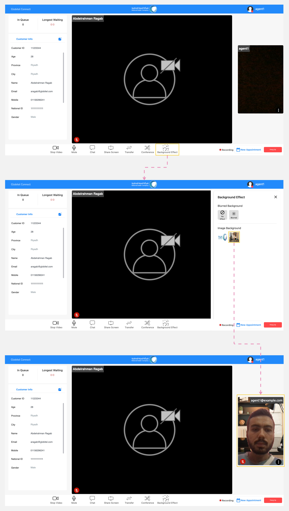
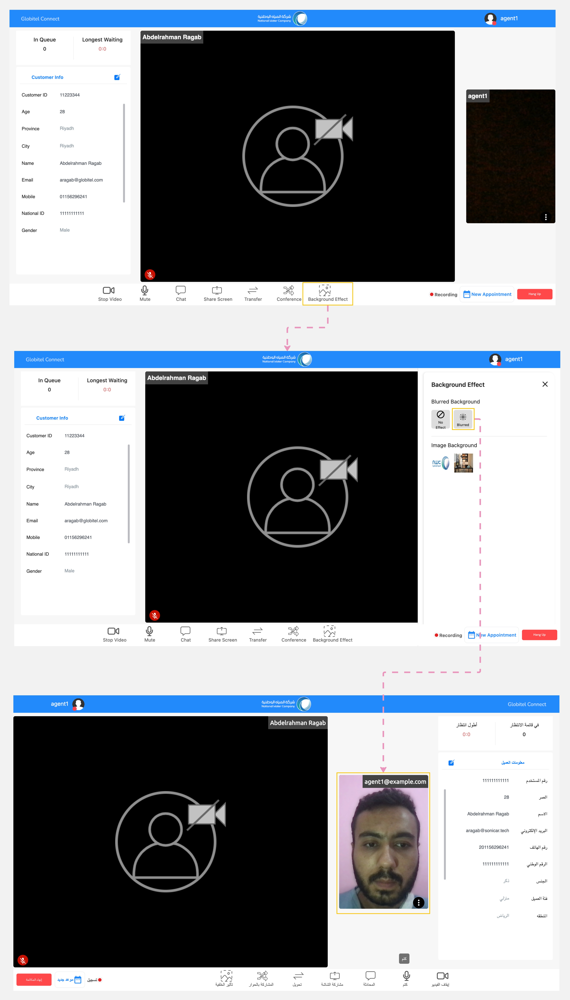

---
tags:
  - Blur Effect
  - Background Effect
  - Change My Background
  - Camera Interacting
---

# Change Background and Blur

---
While using your camera, you can utilize this feature to change or blur the background during customer interactions.

!!! warning "Caution"
    Use this function only when using your camera with a customer.

## How to Change the Background Image?

Follow these steps to change your background image:

1. Click the "Change Background" button located in the conference functions section of the meeting room.
2. A "Background Effect" panel will appear.
3. Select your preferred background image from the "Image Background" section.
4. Finally, you can see this effect in the meeting section. Customers will see this background while interacting with you.

## How to Apply a Blur Effect to the Background?

Follow these steps to apply a blur effect for your background:

1. Click the "Change Background" button located in the conference functions section of the meeting room.
2. A "Background Effect" panel will appear.
3. Select "Blurred" from the "Blurred Background" section.
4. Finally, you can see this effect in the meeting section. Customers will see this background while interacting with you.

!!! tip "Tip"
    You can remove the backgound image or blurred effect by selecting "No Effect" from the "Background Effect" panel.

Related Articles:

- [Room Functions](../Handling-Interactions/Conference-room-functions.md)
- [Chat](../Handling-Interactions/Chat.md)
- [Exchanging Documents](../Handling-Interactions/Exchanging-documents.md)