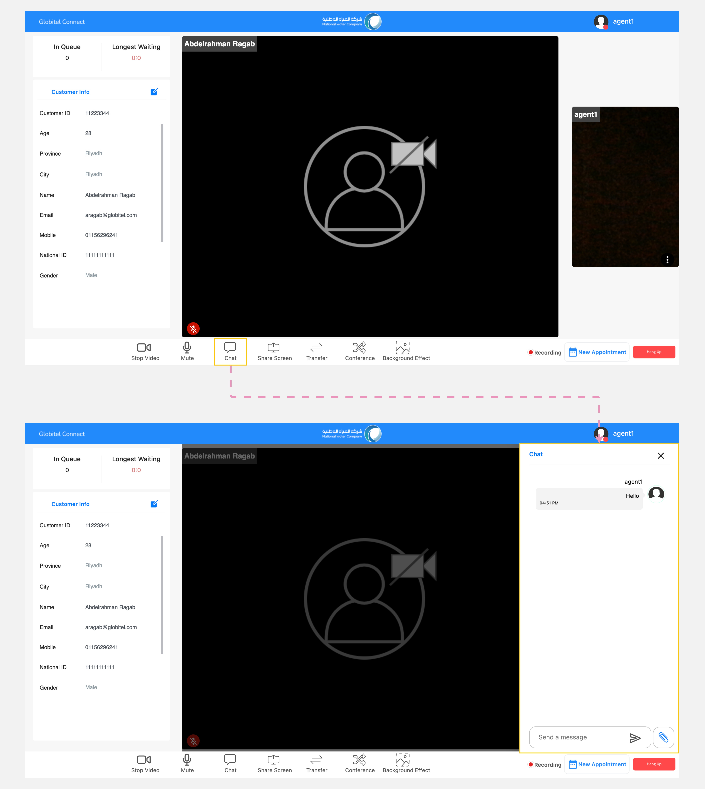

---
tags:
  - Send Messages
  - Chating with Customer
  - Receive Customer Messages
  - Chat
  - Messages
hide:
  - toc
---

# Chat

---
The chat feature allows you to exchange text with customers during an interaction. This feature is especially helpful when you need to share details such as numbers or addresses that require memorization. It's also beneficial when the internet connection is weak and you need to convey crucial information.

How can I chat with customer?

You can chat with a customer by following these steps:

1. Click the "Chat" button located in the conference functions section of the meeting room.
2. The chat panel will appear, where you can view customer messages.
3. To send a message, type it in the message box and press "Enter".

!!! warning "Caution"
    If you have important information related to an interaction, copy that before the call ends. Otherwise, the data from the chat will be lost when the call is ended.

Related Articles:

- [Room Functions](../Handling-Interactions/Conference-room-functions.md)