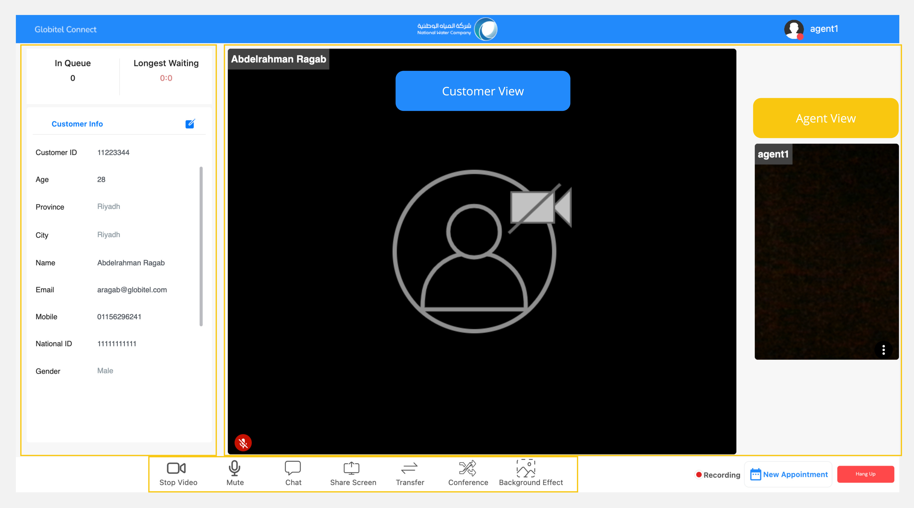
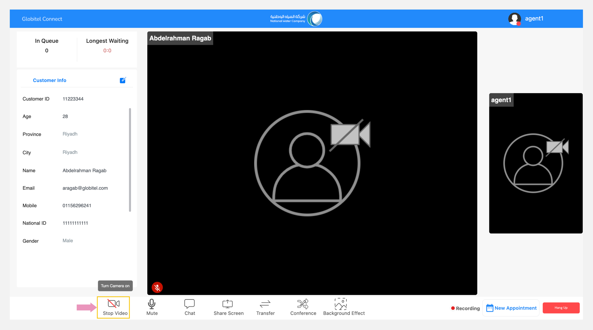
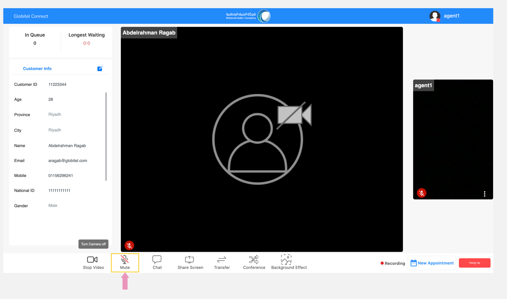
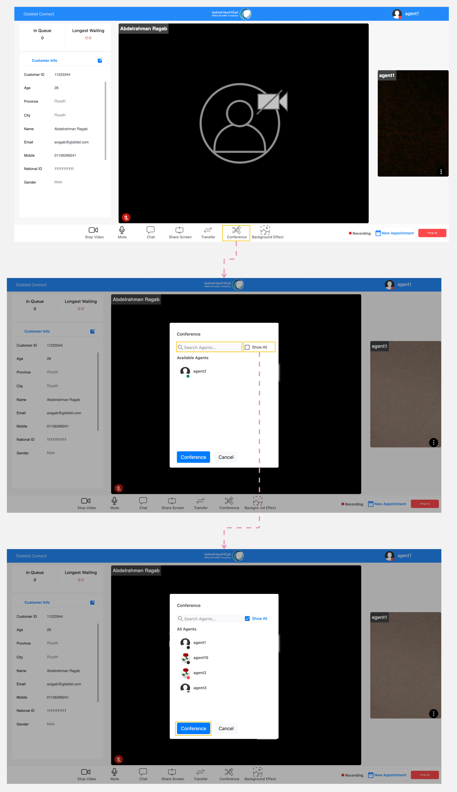

---
tags:
  - Room Functions
  - Room Controls
  - Call Management
  - Conference Call
  - Mute Mic
  - Disable Camera
---

# Conference Room Functions

---
Once you have [answered the call](Receiving-a-new-interaction.md), the conference room will appear, enabling interaction with the customer. You view the customer's photo and hear their voice.

The conference room page is divided into three main sections:

1. Meeting Panel: This section displays the live photos and microphones status of the customer and yourself.
2. Customer Information Panel: This section showcases the customer's information.
3. Conference Functions: This section provides the necessary actions you can perform during the meeting.

## Conference Functions

Here are eight functions you can utilize during interactions with customers in a conference:

1. Turn your camera ON/OFF.
2. Mute/Unmute your microphone.
3. [Share your screen](Screen-sharing.md) with customer.
4. [Transfer the call](Call-Transfer.md) to another ready agent.
5. Initiate a conference call with the supervisor.
6. [Change the background](Change-background-and-blur.md) while sharing your camera.
7. [Chat](Chat.md) with the customer.
8. [Exchange documents](Exchanging-documents.md) with the customer.

### Turn your Camera On/Off

To toggle your camera on or off during customer interaction, click on the "Camera" icon. You can found this in the conference functions section, located at the bottom of the meeting room page.

### Mute/Unmute your Microphone

To toggle your microphone mute or unmute during customer interaction, click on the "Microphone" icon. You can found this in the conference functions section, located at the bottom of the meeting room page.

!!! warning "Caution"
    Do not mute your microphone during interaction with the customer. You may only mute it if your action does not require speaking with the customer.

### Initiate a Conference call with the Supervisor

You can create a conference call with a ready supervisor by clicking on the "Conference" action. The ready supervisor will appear, or you can search for them by name to add them to the meeting.

