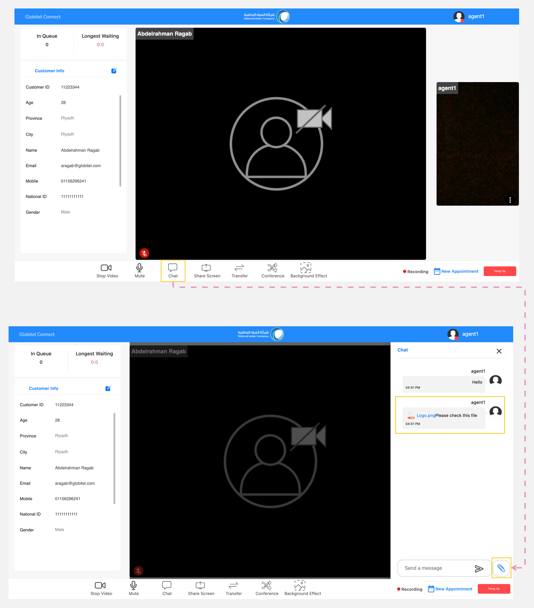

---
tags:
  - Sharing Files
  - Upload Documents
hide:
  - toc
---

# Exchanging Documents

---
The uploading documents feature allows you to exchange files with customers during an interaction. This feature is especially helpful when you need to share documents such as invoices.

How can I share documents with customer?

You can share documents with customer, do the following steps:

1. Click the "Chat" button located in the conference functions section of the meeting room.
2. The chat panel will then appear, where you can view messages or files from the customer.
3. Click on the "File" icon.
4. The file manager will open for you to select the file.
5. Select the specific file that you want to share and press "Enter" to send it to the customer.

!!! warning "Caution"
    If you have important files related to an interaction, download that before the call ends. Otherwise, the files from the chat will be lost when the call is ended.

!!! tip "Tip"
    Supported file types include Images, Videos, Documents (PDF, Docx, XLSX), and Zip files.

Related Articles:

- [Room Functions](../Handling-Interactions/Conference-room-functions.md)
- [Share Screen](../Handling-Interactions/Screen-sharing.md)