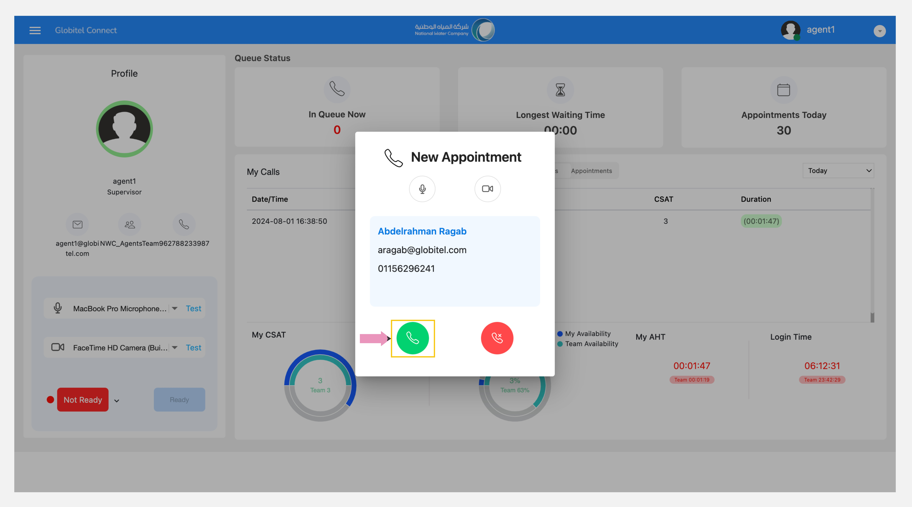
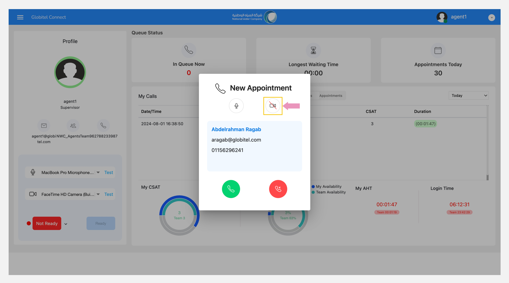
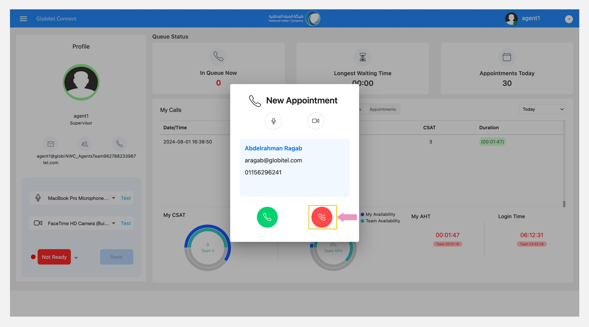

---
tags:
  - Calls
  - Upcoming Interaction
  - Accept Call
  - ٍReject Call
---
# Receiving A New Interaction

---
If you are [ready](../Getting-started/Getting-ready-for-engagements.md), the system will begin sending customers’ interactions for you to handle them.

When a new interaction is allocated to you, a notification window will appear on your screen accompanied by a ringing tone.

This notification window provides the following details:

- Whether the call is for a new appointment or immediate support interaction.
- Options to enable or disable your camera.
- Customer information, including the customer's name, email, and phone number.
- Options to answer or reject this interaction.

## Answer the Call

Press the green "Answer :material-phone:" icon to accept the call and start interacting with the customer.

!!! warning "Caution"
    Be sure to activate the microphone sound and turn on the camera (if required) when answering the call.

## Reject the Call

To reject the call, press the "Reject :material-phone-remove-outline:" red icon.

!!! warning "Caution"
    If you do not answer to an incoming interaction within 5 seconds, the system will assign this interaction to another ready team member and set your status to "Not Ready".
    If you press "Reject", the interaction will be sent back to the queue, and your rejection of the call will be recorded in the system. This option should be used only in emergency situations.

Related Articles:

- [Testing your Camera and Microphone](../Getting-started/Testing-your-camera-and-microphone.md)
- [Call Transfer](../Handling-Interactions/Call-Transfer.md)
- [Change Background and/or Blur](../Handling-Interactions/Change-background-and-blur.md)
- [Chat](../Handling-Interactions/Chat.md)
- [Exchanging Documents](../Handling-Interactions/Exchanging-documents.md)
