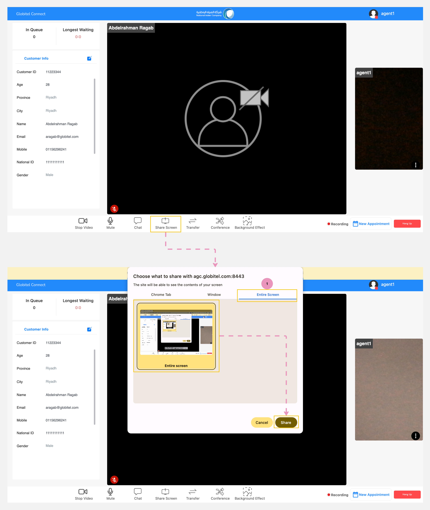

---
tags:
  - Share Screen
  - Sharing
hide:
  - toc
---

# Screen Sharing During the Interaction 

---
During customer interactions, you can share your screen to provide necessary information or explain how to use the services that require screen sharing.

How can I share my screen with a customer?

It's simple, just do follow these steps:

1. Click on the "Share Screen" button, which is located in the meeting functions section.
2. In the pop-up window, select the required tab, such as Chrome Tab, Window, or Entire Screen.
3. Then, select the screen you need to share.
4. Finally, commence screen sharing by clicking on the "Share" button.

!!! tip "Tip"
    To stop sharing your screen, simply click the "Share Screen" button again. It's located in the meeting functions section.

Related Articles:

- [Room Functions](../Handling-Interactions/Conference-room-functions.md)
- [Exchanging Documents](../Handling-Interactions/Exchanging-documents.md)