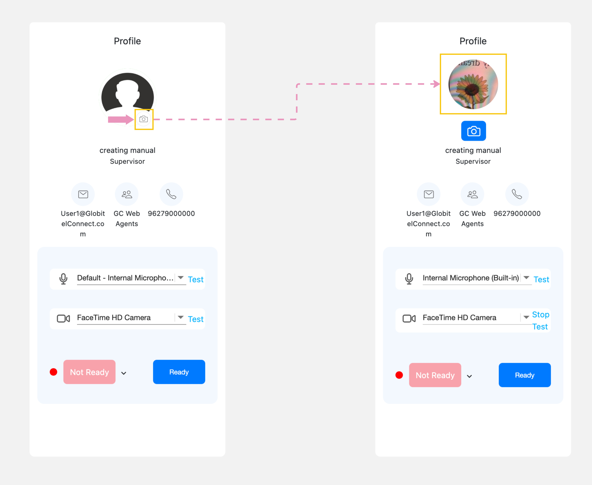

---
tags:
  - Update My Photo
  - Change My Picture
  - My Profile Photo
hide:
  - toc
---

# Modify Profile Photo

---
You can update your profile picture through the profile section located within your workspace (dashboard) by clicking on the camera icon next to the default photo to activate the camera and take a profile photo so that it appears to customers when interacting with them.

Related Articles:

- [Dashboard](../Getting-started/My-dashboard.md)
- [Testing your Camera and Microphone](../Getting-started/Testing-your-camera-and-microphone.md)
