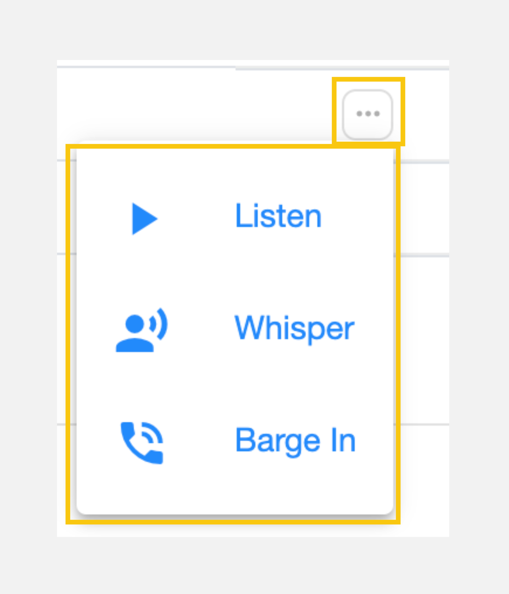
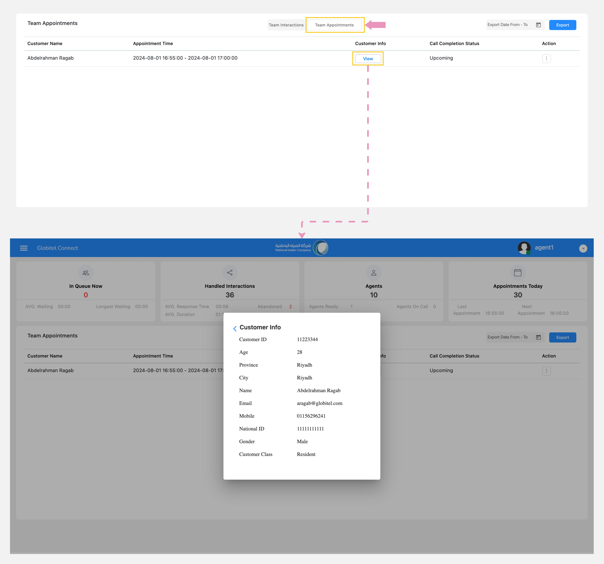
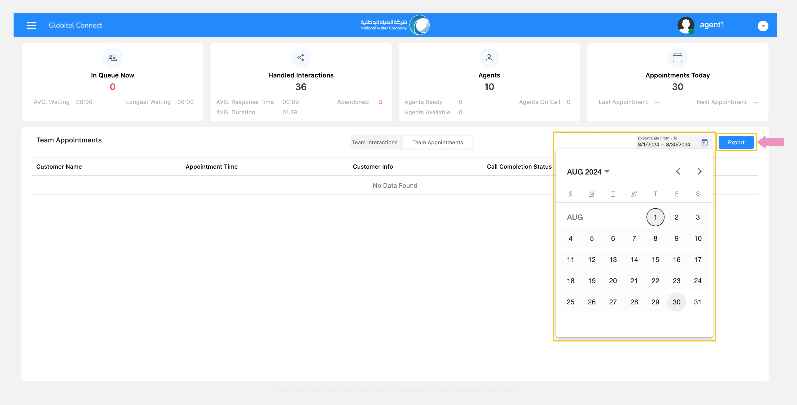
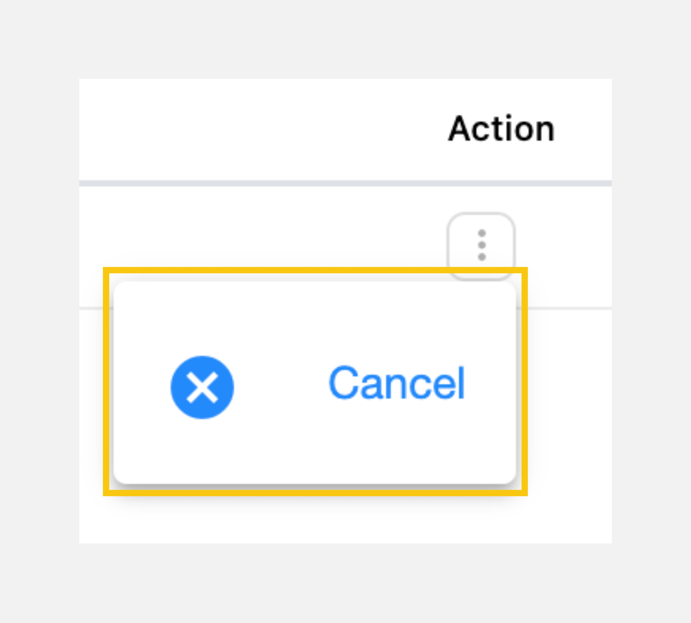

---
tags:
  - Monitor My Team
  - Monitor Interactions
  - Monitor Appointments
  - Take Actions
  - Track Team
  - Export Appointments
---

# Monitoring Team Interactions & Appointments

---
This feature allows you to monitor all of your team's interactions and appointments and is divided into two sections:

- Team Interactions: Provides you with the status of the team's availability and offers statistics on customer satisfaction and the number of calls handled for each agent.
- Team Appointments: Provides a list of all appointments that have been booked and the completion status of each call.

## Team Interactions

The "Team Status" tab allows supervisors to track the interactions of each team member (agent) in real-time.

!!! tip "Tip"
    You can filter your team interactions by "This Month", "Today", "This Week", or "Last Month".

The following information is available:

| Name | Description |
| :------------ | :--------- |
| Agent Name | This is the full name of the agent, given in the format: First Name, Last Name. |
| Current Status | This shows the agent's real-time status and time, indicating whether they are online, ready for calls, currently on a call, or offline. |
| Log In Time | This shows the date and time the agent logged into the system. |
| Handled | This is the total number of calls the agent has handled. |
| AHT (Sec) | This is the average duration of calls managed by agents in seconds. |
| CSAT (Customer Satisfaction Score) | This displays the customer's rating based on the rating survey results after the interaction and is a rating from 1 (lowest rating) to 5 (highest rating). |

!!! tip "Tip"
    The colors on the current status indicate the start and end periods. For instance, green indicates 0 to 2 minutes, yellow indicates 2 to 4 minutes, and red represents 4 to up.

Also, you can view the call statistics and charts as follows:

- Team CSAT (%): Displays the Customer Satisfaction Score (CSAT) percentage out of 100, based on survey results for your team.
- Team Availability (%): Shows data on agent availability for your team. It calculates the ratio between overall ready time and duty time for selected durations (today, this week, this month, and last month). Ready time includes on-call and available time, while duty time encompasses on-call, available, online, do not disturb, and break times.
- Team AHT (HH:MM:SS): Displays the average handling time (AHT) for all records, measured in hours, minutes, and seconds, for your team.
- Team Login Time (HH:MM:SS): Displays the total logged-in time from the moment of login to the current time for your team, measured in hours, minutes, and seconds.

### What actions can I take to monitor a current interaction (3-dot icon - :material-dots-horizontal-circle:)?

{ width=150, align=right }

In the "Team Status" section, supervisor can perform actions by clicking on the options icon. Actions such as "Listen," "Whisper," or "Barge In" are available during an active interaction.

- Listen: This feature allows the administrator to silently listen in on a call made or answered by an agent. This can aid in assessing the agent's performance and understanding customer interactions.
- Whisper: This feature enables the administrator to provide live advice and guidance to an agent during a call. The administrator's line is unmuted, but the audio is only delivered to the agent, thus not interrupting the call.
- Barge In: This feature allows administrators to join a live call, making it a three-way conversation. This is particularly useful in situations where the agent may need assistance in handling a difficult call.

## Team Appointments

The "Team Appointments" tab enables supervisors to monitor and manage all appointments across the entire organization in real time.

The following information is available:

| Name | Description |
| :------------ | :--------- |
| Customer Name | This shows the full name of the customer. |
| Appointment Time | This displays the appointment booking slot by the customer in date and time format. |
| Customer Info | Displays all information about the customer, including required details. |
| Call Completion Status | This displays the current status of the appointment if it is upcoming, rescheduled, completed, or cancelled. |
| Action (3-dot icon) | Allows the supervisor to cancel upcoming appointments. |

!!! tip "Tip"
    The supervisor can export appointments by selecting start and end dates, then clicking export to download the team appointments as an Excel file.

### What actions can I take to manage appointments (3-dot icon - :material-dots-horizontal-circle:)?

{ width=100, align=right }Supervisors can cancel a scheduled appointment by selecting it from the team appointments tab, clicking the three-dot icon under ‘Actions,’ and confirming the cancellation.

Related Articles:

- [Dashboard (Workspace)](../Getting-started/My-dashboard.md)
