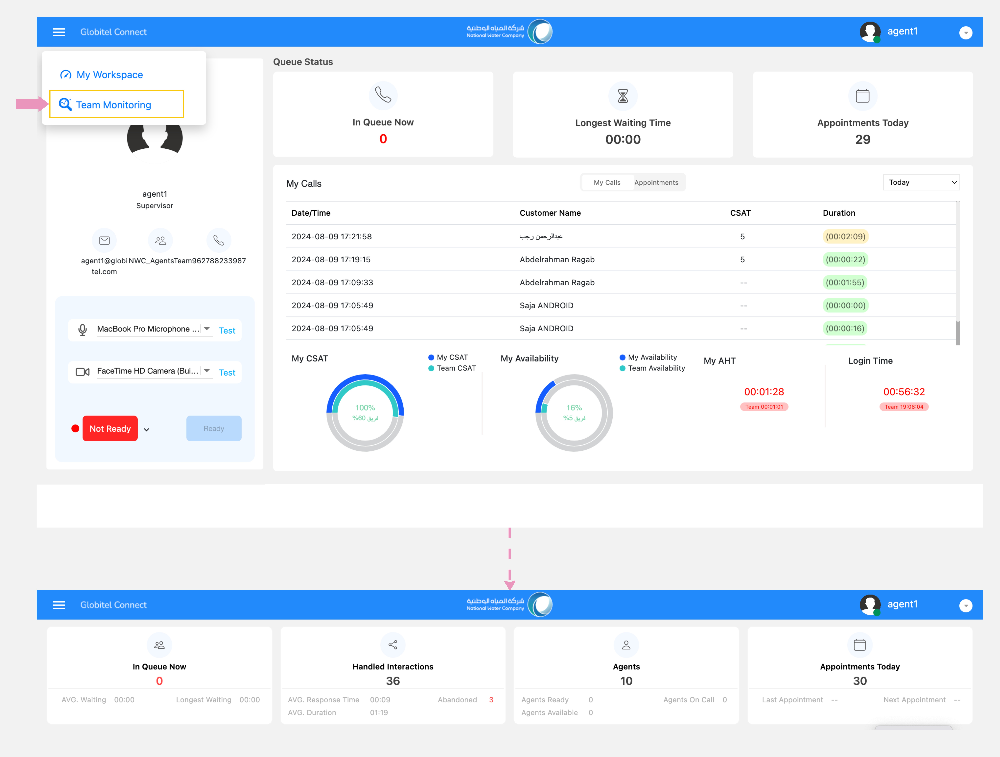

---
tags:
  - Monitor My Team
  - Track Team
  - Agents Performance
  - Team Charts
  - Team Stats
---

# Track Agents Performance

---
As a supervisor, you can oversee your team's performance and access a detailed statistical analysis of agent statuses.

How can I access the team monitoring page?

To access the team monitoring page, follow these steps:

1. Click the options icon on the left side of the header.
2. From the drop-down menu, select "Team Monitoring".
3. You will view the team monitoring page.

There are four cards on the team monitoring page, described as follows:

## In Queue Now

The "In Queue Now" card provides managers with real-time statistics about customers for the current day:

- In Queue Now (#): Displays the total number of customers currently in the virtual queue awaiting agent interaction.
- AVG. Waiting (MM:SS): Displays the average waiting time of customers who typically wait beyond the Acceptable Average Wait Time, a time configured by the administrator (default is 10 minutes).
- Longest Waiting (MM:SS): Indicates the wait time of the customer who has been waiting the longest.

## Handled Interactions

Within the "Handled Interactions" card, managers can view the following real-time statistics about handled calls for the current day:

- Handled Interactions (#): This represents the total number of interactions answered by agents, not including those that were abandoned.
- AVG. Response Time (MM:SS): The `Average Response Time` shows the average time taken to initially respond to customer calls.
- AVG. Duration (MM:SS): The `Average Handle Time` represents the average duration of calls managed by agents.
- Abandoned: This displays the total number of calls abandoned by customers.

## Agents

The "Agents" card enables managers to view the following real-time statistics about agents for the current day:

- Agents (#): This shows the total number of agents in the team.
- Agents Ready (#): This represents the total number of agents ready to accept customer calls.
- Agents Available (#): This signifies the total number of agents currently active and available in the system.
- Agents On Call (#): This indicates the total number of agents currently engaged in customer calls.

## Appointments Today

Within the "Eligible Appointments Today" card, managers can view the following real-time statistics about the last and next appointments for the current day:

- Appointments Today (#): This represents the total number of appointments for the current day.
- Last Appointment: This indicates the time slot allocated for the last appointment of the day.
- Next Appointment: This represents the time slot designated for the next upcoming appointment.

Related Articles:

- [Dashboard (Workspace)](../Getting-started/My-dashboard.md)
